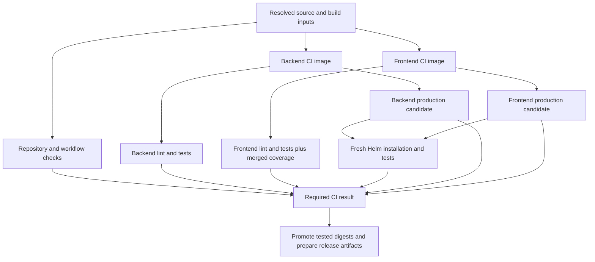

# ADR 0023: Optimize CI execution and caching

- Status: Accepted
- Proposed date: 2026-11-05
- Accepted date: 2026-11-05

## Context

[Issue #475](https://github.com/cloud-native-aixmarseille/pleey/issues/475) requests
measurable CI improvements without stale caches or reduced reliability. The
[shared pipeline](../../../../.github/workflows/__shared-ci.yml) serves PRs, main,
and releases. Its critical path crosses image building, reusable-workflow setup,
application tests, production image publication, and Helm installation. Improving
Docker caching alone leaves several independent sources of delay unchanged.

### Audit evidence: 2026-11-05

The sample comprises five successful PR runs
([42039011250](https://github.com/cloud-native-aixmarseille/pleey/actions/runs/42039011250),
[42007492180](https://github.com/cloud-native-aixmarseille/pleey/actions/runs/42007492180),
[41997449273](https://github.com/cloud-native-aixmarseille/pleey/actions/runs/41997449273),
[41985424044](https://github.com/cloud-native-aixmarseille/pleey/actions/runs/41985424044),
[41978511658](https://github.com/cloud-native-aixmarseille/pleey/actions/runs/41978511658))
and five successful main runs
([42004084531](https://github.com/cloud-native-aixmarseille/pleey/actions/runs/42004084531),
[41987313343](https://github.com/cloud-native-aixmarseille/pleey/actions/runs/41987313343),
[41982073046](https://github.com/cloud-native-aixmarseille/pleey/actions/runs/41982073046),
[41975502607](https://github.com/cloud-native-aixmarseille/pleey/actions/runs/41975502607),
[41972777934](https://github.com/cloud-native-aixmarseille/pleey/actions/runs/41972777934)).

| Measurement                              | PR median       | Main median     |
| ---------------------------------------- | --------------- | --------------- |
| Workflow elapsed, creation to completion | 16m 39s         | 18m 24s         |
| Workflow elapsed range                   | 14m 02s–20m 35s | 16m 52s–20m 53s |
| Sum of non-skipped job durations         | 27m 23s         | 34m 17s         |
| Backend CI image job                     | 1m 08s          | 3m 02s          |
| Frontend CI image job                    | 1m 52s          | 1m 58s          |
| Frontend test job                        | 4m 19s          | 4m 40s          |
| Backend test job                         | 1m 44s          | 1m 31s          |
| Backend production image job             | 59s             | 2m 29s          |
| Helm chart test job                      | 3m 17s          | 3m 14s          |
| Repository lint job                      | 2m 31s          | 3m 49s          |

These are exploratory samples with different commits and cache histories, not a
controlled before/after benchmark. Job durations include setup and teardown;
parallel jobs must not be added to estimate elapsed time. Their sum is a resource
usage proxy, not billing. The first PR has about 65s of initial queue/dispatch delay.
The latest successful release run, dated 2026-09-09, predates the current pipeline
and is not a current release baseline.

Detailed logs for the first PR and main run establish the following:

- CI images already contain compiled applications, but the Node workflow compiles
  them again. Tests start in separate containers and do not consume that second
  build's output. Container initialization takes 19–33s per application job.
- Image publication adds a shared barrier after both image builds, followed by
  attestation jobs. In the PR publication job, Docker/Buildx setup takes 26.3s,
  while the single-platform manifest script and digest inspection take under 1s
  together. All current application images target only `linux/amd64`.
- Frontend Vitest execution takes about 211–221s across 228 files; backend takes
  29–35s. Frontend import and environment phases each account for about 28% of
  summed tracked phase time. These percentages span workers and are not fractions
  of wall time. All frontend tests currently use jsdom and the shared UI setup.
- Automatic report discovery spends about 8–10s per application lint job and finds
  no supported lint report despite Biome producing JSON. Test report discovery
  scans for files whose names are already known.
- Super-Linter image pulls take 70–87s; actual lint execution takes 64–160s.
  The shared image already derives from Super-Linter slim, and validators already
  run in parallel. Repository lint is off the current critical path.
- Helm setup spends 5–25s on chart-testing tooling, 4–11s preparing dependencies,
  about 45s creating kind, and 109–124s installing/testing the chart. Actual chart
  lint takes under 1s. Both successful runs contain two failed migration pods with
  Prisma `P1001` before a successful retry. The current database wait checks secret
  file existence, not database connectivity.
- BuildKit already uses GitHub Actions layer caches and persists cache mounts with
  `actions/cache` and `buildkit-cache-dance`. CI/prod have separate layer scopes.
  In the main backend builds, installation repeats for 22.7s/21.4s and compilation
  for 9.6s/9.3s. Cache export itself takes 99.2s/70.7s. The warm PR reuses these
  layers successfully, so simply enabling or enlarging caching is not the answer.

The audit follows the pinned
[container workflow](https://github.com/hoverkraft-tech/ci-github-container/blob/5ffc3c81daacc57700a14bb91d67edbc67eedc1d/.github/workflows/docker-build-images.yml),
[Node workflow](https://github.com/hoverkraft-tech/ci-github-nodejs/blob/1f81dd00d941680ab227a6eae5378790d6242e02/.github/workflows/continuous-integration.yml),
and [linter workflow](https://github.com/hoverkraft-tech/ci-github-common/blob/44f6108cef0e9884ea7735f3d62932c2310745d4/.github/workflows/linter.yml).
Proposed upstream capabilities below are not assumed to exist in those revisions.

The same day's GitHub API inspection returned `Branch not protected` for main's
classic protection, a disabled `default-branch` ruleset, and no effective rules
for `main`. Recheck at rollout: the aggregate-check task may require enabling
enforcement, rather than replacing an existing required check.

### P0 baseline protocol: 2026-11-05

The first phase records the accepted direction, validation inventory and a
controlled PR baseline. Its [machine-readable evidence](./evidence/0023-ci-baseline.json)
records source fingerprints, locked tools, enforcement state and attempt-specific
measurements. The starting main commit is
[`aa7d9223`](https://github.com/cloud-native-aixmarseille/pleey/commit/aa7d922386c5b707d19bf5bc8da9715c4f4066f1).
P0 pins application base-image inputs after the initial series exposed tag drift.
Workflow ordering, application commands, cache configuration and charts remain unchanged.

| Existing validation branch | Required inputs and outcome                                                                                                                   |
| -------------------------- | --------------------------------------------------------------------------------------------------------------------------------------------- |
| Repository lint            | Current checkout, shared linter image/config and rendered-chart fixture; preserve all enabled checks                                          |
| CI image builds            | Per-service Dockerfile, lockfile, source/generated inputs and shared scripts; build, publication and required signatures/attestations succeed |
| Application lint/tests     | Built service image and source path mapping; both services' lint/build/tests and report processing succeed                                    |
| Production images          | Both application lanes complete; preserve normal tag, signing and provenance behavior                                                         |
| Umbrella chart             | Both immutable production image digests; fresh cluster, dependency preparation, lint, installation and chart tests succeed                    |
| Independent PR checks      | Existing semantic-title and workflow/security checks remain visible alongside shared CI                                                       |

Existing code-query/dependency-review options disabled in the caller are not new
required checks. No aggregate enforcement rule existed at baseline. The original
plan assigned it to P3; the [P3 scope adjustment](#p3-service-lanes-2026-11-11)
defers it until candidate-promotion work. Repository rules remain unchanged.

The initial phase PR run validates the inputs and primes its cache. Collect
five comparable successful attempts of an unchanged revision and event. Inspect
resolved image/tool inputs and cache availability before including attempts.
The measurement correction below retains cache misses after priming. Keep failures
and changed-input samples with reasons; do not select only favorable timings. Store attempt-specific job/step timings
and links rather than querying only the latest attempt of a rerun.

For reruns, `created_at` belongs to the original run. Measure each attempt from
its `run_started_at` to the latest job completion, separately reporting initial
queue delay and summed job durations. Preserve job intervals to expose later
scheduling waits. Compare medians and ranges after the full sample completes.

| Subsequent comparison scenario | Controlled inputs and evidence                                                                                                |
| ------------------------------ | ----------------------------------------------------------------------------------------------------------------------------- |
| Warm                           | Same inputs, event and cache scope after priming; five consecutive attempts, retaining cache misses                           |
| Cold                           | Explicitly bypass both layers and mount restoration in an isolated validation run; record successful declared-input execution |
| Dependency change              | Change one lockfile and record the corresponding install/cache invalidation while the other service remains controlled        |
| Source change                  | Change one source input and verify intended compile/test invalidation without unnecessary dependency installation             |
| Shared/generated/chart change  | Verify all consumers of shared scripts, Prisma/GraphQL inputs and local chart sources invalidate correctly                    |

Cold and changed-input cases are defined here for later implementation comparisons;
P0 does not claim to have executed optimizations or invalidation experiments.
Historical main timings remain separate. A controlled main baseline follows the
reviewed merge; do not rerun an older main publication merely to obtain a sample.
Record runner/image information and test/coverage summaries emitted by the current
pipeline. Label unreported CPU/memory, coverage denominator and cache details as
unavailable; obtain additional telemetry before the relevant P1/P6 comparison.

### P0 controlled PR evidence: 2026-11-05

[Phase PR #552](https://github.com/cloud-native-aixmarseille/pleey/pull/552) validates
the initial, superseded series without changing pipeline behavior. Its revision is
`f29d1fea13d6effd157ef8168b8082281a6edf23`, with the shared workflow resolved from
merge commit `a0b8cbac67b4a36ad5f3662b2234ad68ad53a827`.

| Run / attempt                                                                                             | Classification        | Attempt elapsed | Summed job time | Initial queue |
| --------------------------------------------------------------------------------------------------------- | --------------------- | --------------- | --------------- | ------------- |
| [42088318092 / 1](https://github.com/cloud-native-aixmarseille/pleey/actions/runs/42088318092/attempts/1) | diagnostic-excluded   | 6m 53s          | 15m 59s         | 3s            |
| [42089202414 / 1](https://github.com/cloud-native-aixmarseille/pleey/actions/runs/42089202414/attempts/1) | warm                  | 16m 24s         | 26m 02s         | 83s           |
| [42089202414 / 2](https://github.com/cloud-native-aixmarseille/pleey/actions/runs/42089202414/attempts/2) | warm                  | 16m 06s         | 27m 25s         | 4s            |
| [42089202414 / 3](https://github.com/cloud-native-aixmarseille/pleey/actions/runs/42089202414/attempts/3) | warm                  | 14m 14s         | 25m 44s         | 6s            |
| [42089202414 / 4](https://github.com/cloud-native-aixmarseille/pleey/actions/runs/42089202414/attempts/4) | input-change-excluded | 15m 31s         | 27m 10s         | 4s            |

The three equivalent warm attempts have a **provisional median of 16m 06s**
(range 14m 14s–16m 24s), with median summed job time **26m 02s**
(range 25m 44s–27m 25s). These are baseline observations, not achieved savings.
This series is superseded by the pinned-input series below. Do not combine its
three warm runs with the restarted five-sample baseline.

Attempt 4 passed CI but resolved `nginx:1.31-alpine` to a different immutable
image. Its digest changed from
`sha256:785835ea65db4bba6f021acc0f3be91b0fef76a53fe41f8588c6698d2aed0606` to
`sha256:a46f57e097e8effc26192437d2e715adf74bcbea836117651ee436c27983fa41`.
The source revision and Node base stayed fixed, and npm/generation/compile steps
were cached, but the production input set changed. Retain this run as
changed-input evidence and exclude it from the equivalent warm group. This is
why source SHA alone does not identify a reproducible build. The user approved pinning application base images and restarting the full
five-run baseline on 2026-11-05.

The first revision's Markdown-formatting failure was corrected. Its cancelled
attempt is retained separately: the first failed step completed after 137s, and
its consumed job time is not included in successful-run statistics.

The [test inventory](./evidence/0023-test-inventory.csv) records 162 backend files
(149 passed, 13 skipped; 1,218 passed and 60 skipped tests) and 228 frontend files
(1,178 passed tests). Inventories and printed coverage summaries match across the
three equivalent runs. Existing optional disabled jobs remain outside the required
validation inventory. Fresh chart logs still contain Prisma `P1001` before a
successful migration; the evidence records log occurrences, not inferred pod counts.

Build/publication hosts reported four CPUs and 15.61 GiB Docker memory. Hosted
Ubuntu image releases varied within the series and are recorded per attempt.
Effective test-worker count, peak process memory and the coverage denominator are
not emitted by the current retained reports; gather them before the corresponding
P1/P6 experiments. Cache transfer spans can overlap and must not be summed to
estimate workflow elapsed time.

Raw job/step intervals, resolved inputs, cache events and test summaries are linked
from the [evidence JSON](./evidence/0023-ci-baseline.json). The plan documents
attempt-specific API collection. Review P0 before starting any P1 implementation;
controlled main/release validation remains subject to the protocol above.

### P0 input pinning and restarted baseline: 2026-11-05

Pin the Node base in both application Dockerfiles and the frontend Nginx base
using `tag@sha256:digest`. Registry inspection verified OCI image-index digests,
including Linux amd64 and arm64 manifests; selecting the index preserves platform
selection for local builds. The chosen Nginx input is the successfully validated
image from the discarded fourth attempt. Keep the readable version tag alongside
the digest. The exact references are maintained in the
[backend](../../../../application/backend/Dockerfile) and
[frontend](../../../../application/frontend/Dockerfile) Dockerfiles.

This is an additional accepted P0 decision: mutable base tags invalidated the
measurement, so fixed application base inputs are a prerequisite to the restarted
baseline. Pinning makes image refresh explicit; security updates now require a
reviewed digest change. Existing weekly Docker
[Dependabot configuration](../../../../.github/dependabot.yml) covers both files.
Review those updates promptly and keep both Node references aligned. See
[Docker's digest-pinning guidance](https://docs.docker.com/build/building/best-practices/#pin-base-image-versions).

The initial restart protocol required five attempts with all dependency/compile
layers cached, identical resolved inputs and matching test inventories. Recurring
misses on unchanged inputs exposed selection bias in that criterion; the dated
measurement correction below supersedes the all-hit filter. The previous
unpinned series contributes no samples to the restarted baseline.

Pinning application images does not freeze apt/apk repositories, hosted runner
releases, tools installed by upstream workflows or chart dependency tags. Record
observable resolved inputs and runner variance; do not claim byte-identical cold
builds. The root linter Dockerfile is not the image used by the pinned shared CI
linter, so changing that unrelated input is outside this baseline adjustment.

### P0 measurement correction: 2026-11-06

Use five consecutive successful attempts after the initial cache-priming run,
with the same source revision, event, cache scope, resolved application images,
reported build tools and test inventories. Cache imports must be available, but
cache hits are a measured result, not an inclusion criterion. Retain failures and
input changes separately and investigate them before completing a comparable
series. Do not rerun until only favorable timings or perfect cache hits remain.

On the pinned revision, attempt 2 reused every dependency/compile layer. Attempts
3 and 4 executed frontend CI compilation and backend production compilation/pruning
again despite successful cache imports. This repeated work is part of the behavior
issue #475 aims to improve. Selecting only the all-hit attempt would hide it. Preserve
the original cache-hit classifications in the JSON alongside baseline inclusion.
The logs establish execution but do not establish the invalidation cause; carry
that investigation into the cache experiments, without changing caching in P0.

For cache telemetry, `cached` means an explicit BuildKit CACHED marker with no
observed command output. Parse each main build invocation separately because step
numbers restart in cache-mount helper builds. A missing CACHED marker can represent
layer materialization; `command_output_observed` distinguishes visible command
execution from that case. Cache transfer spans may overlap and are not additive.

The restarted series is revision
[`7a561944`](https://github.com/cloud-native-aixmarseille/pleey/commit/7a561944cb590b1937f547fe7deb3d6a654f7e17).
Attempt 1 primes the changed Dockerfile inputs; attempts 2–6 form the baseline.
Attempt 6 runs on 2026-11-06 after the session interruption. Record its scheduling
and runner variance alongside the earlier attempts; the revision stays fixed.
All five attempts passed input checks; the completed results follow.

### Completed P0 baseline: 2026-11-06

All five post-priming attempts passed the active validation jobs on the pinned
revision above, with matching source/workflow revisions, observed application and
build-tool image identities, and test-file inventories. Optional jobs disabled by
the caller remained skipped. The initial priming run is retained separately.

| Attempt                                                                                     | Included    | Cache evidence              | Elapsed | Summed job time | Initial queue |
| ------------------------------------------------------------------------------------------- | ----------- | --------------------------- | ------- | --------------- | ------------- |
| [1](https://github.com/cloud-native-aixmarseille/pleey/actions/runs/42101244328/attempts/1) | no: priming | partial reuse               | 17m 08s | 30m 55s         | 3s            |
| [2](https://github.com/cloud-native-aixmarseille/pleey/actions/runs/42101244328/attempts/2) | yes         | all dependency/compile hits | 15m 04s | 26m 58s         | 5s            |
| [3](https://github.com/cloud-native-aixmarseille/pleey/actions/runs/42101244328/attempts/3) | yes         | partial reuse               | 15m 00s | 26m 23s         | 5s            |
| [4](https://github.com/cloud-native-aixmarseille/pleey/actions/runs/42101244328/attempts/4) | yes         | partial reuse               | 15m 31s | 26m 41s         | 5s            |
| [5](https://github.com/cloud-native-aixmarseille/pleey/actions/runs/42101244328/attempts/5) | yes         | partial reuse               | 16m 46s | 28m 14s         | 6s            |
| [6](https://github.com/cloud-native-aixmarseille/pleey/actions/runs/42101244328/attempts/6) | yes         | partial reuse               | 15m 44s | 27m 17s         | 5s            |

- Workflow elapsed: median **15m 31s**, range 15m 00s–16m 46s.
- Summed non-skipped job time: median **26m 58s**, range 26m 23s–28m 14s.
- Cache behavior: 1 of 5 samples had explicit hits for every dependency/compile step; 4 retained partial reuse.

These are before-change measurements for later comparisons, not an optimization
gain. Selected job durations include setup and teardown; parallel spans cannot be
added to estimate workflow elapsed time.

| Job                                                    | Median | Range         |
| ------------------------------------------------------ | ------ | ------------- |
| Repository lint                                        | 2m 32s | 2m 26s–2m 39s |
| ci / build / Build image backend-ci for linux/amd64    | 1m 00s | 0m 54s–2m 10s |
| ci / build / Build image frontend-ci for linux/amd64   | 1m 10s | 0m 54s–1m 39s |
| ci / continuous-integration (frontend) / 🧪 Test       | 4m 27s | 3m 33s–5m 31s |
| ci / continuous-integration (backend) / 🧪 Test        | 1m 42s | 1m 27s–1m 48s |
| ci / build-prod / Build image frontend for linux/amd64 | 0m 52s | 0m 44s–1m 20s |
| ci / build-prod / Build image backend for linux/amd64  | 1m 43s | 0m 56s–2m 00s |
| ci / tests-charts                                      | 3m 10s | 3m 04s–3m 55s |

Discovered files and counts remain 162 backend files (1,218 passed / 60 skipped
tests) and 228 frontend files (1,178 passed tests). Printed coverage percentages
vary on unchanged inputs:

| Service  | Statements   | Branches     | Functions    | Lines        |
| -------- | ------------ | ------------ | ------------ | ------------ |
| backend  | 75.17–75.18% | 65.91–65.91% | 67.11–67.17% | 76.37–76.39% |
| frontend | 82.87–83.14% | 75.52–75.74% | 81.86–82.02% | 83.36–83.65% |

The underlying coverage denominator and case-level reports are unavailable in the
retained artifacts, so these percentages do not prove identical coverage maps.
Capture those before changing test environments or shards. Peak process memory
and effective test-worker counts remain unreported. Kind node tags are observed,
but their resolved digests and mutable chart dependency images are not fully
emitted; the baseline is not hermetic. The run evidence also retains Prisma
`P1001` log occurrences before successful chart installation for the planned
readiness work.

The [evidence bundle](./evidence/0023-ci-baseline.json) links every attempt's job
and step CSV, input identity, cache observation, printed test/coverage summary and
runner metadata. Its original strict cache-hit classification remains available
for comparison with the revised inclusion rule. P0 implementation and PR baseline
collection are complete; final documentation CI and user review gate P1. Main and
release measurements follow the publication-safe protocol above after review.

## Decision Drivers

- Shorten the critical path and reduce redundant runner work across all stages.
- Retain application, repository, security, coverage, and installation checks.
- Separate independent computation from approval to publish trusted artifacts.
- Preserve cold execution, deterministic input selection, and useful failure reports.
- Improve shared upstream tooling instead of copying it into Pleey.
- Keep independently useful local changes deliverable while upstream work proceeds.

## Considered Options

### Option 1: Tune Docker caching within the existing DAG

Useful for repeated builds, but leaves serial validation/deployment work, repeated
job setup, frontend browser environments, and Helm retries untouched.

### Option 2: Optimize the full DAG and each measured stage incrementally

Retain container-based checks, remove unnecessary barriers and setup, improve test
execution and readiness, and measure cache transfer as part of total runtime.
Introduce explicit candidate-artifact and publication gates where parallelism needs them.

### Option 3: Replace image-based checks with host jobs and build artifacts

Avoids some image distribution, but introduces another environment and contracts
for native dependencies, generated files, builds, and reporting. Benchmark this
only if the optimized container path remains dominated by image distribution.

### Option 4: Use larger runners or persistent builders/runners throughout

May reduce CPU or download costs, but adds compute expense or maintenance,
isolation, and cache-lifecycle responsibilities. Larger hosted runners are a
targeted experiment after CPU/memory measurement; a persistent runner fleet is
not the initial decision.

## Decision

Choose option 2. Implementation proceeds one phase at a time, with a separate PR
and CI validation for each phase. The user reviews each phase before the next
begins. Acceptance of this direction does not claim that optimizations have been
implemented or savings achieved. Adopt each change only with its correctness
checks and measured benefit; measure elapsed time and resource use separately.

### Execution graph and publication gates

Replace the global sequence of application checks followed by production work with
independent validation branches. The intended graph is:



Image nodes include their required signing and attestations. Production candidate
builds start after their CI images, in parallel with application checks, and reuse
the completed CI cache. Helm needs both candidate digests, not the outcome of
unit tests. The final gate requires every expected validation branch and security
output to succeed. It evaluates failed, cancelled, and unexpectedly skipped jobs
explicitly; a skipped dependency must not produce a passing aggregate check.
This follows GitHub's [job dependency semantics](https://docs.github.com/en/actions/how-tos/write-workflows/choose-what-workflows-do/use-jobs).

This requires a publication contract before changing `needs`. The existing
`images[].tag` override already selects a forced tag and disables `latest` in the
[metadata action](https://github.com/hoverkraft-tech/ci-github-container/blob/5ffc3c81daacc57700a14bb91d67edbc67eedc1d/actions/docker/get-image-metadata/action.yml).
Reuse it for run/attempt-scoped candidate identifiers without moving consumer tags
early. The missing contract separates temporary tags from planned destinations
and final OCI metadata, then governs promotion, reruns, and cleanup. Promotion
retags the tested immutable digest after the gate, without rebuilding. Supply the
planned release version/OCI metadata at build time, retain signatures/provenance,
and verify the promoted digest matches the chart-tested artifact. Validate the
rendered release chart again after release-file updates. Update required-check
configuration together with job names so branch protection remains effective.

Expose separate backend/frontend completions so frontend checks need not wait for
backend images. The current workflow already accepts a one-image list: Pleey can
use two explicit caller jobs, each with its own downstream lane. A matrix child
cannot release a downstream caller while the entire reusable-workflow call is
still running. Benchmark the extra publication/setup work from separate calls;
retain the shared barrier if that overhead outweighs the overlap until upstream
setup reductions land. Reuse the workflow rather than copying its internals.

For the illustrated PR/main runs, the application branch spans 338s/325s and the
subsequent production-plus-Helm branch spans 405s/506s. Ideal overlap could hide up
to 338s/325s. This is a critical-path model, not a forecast: queueing, contention,
promotion work, and cache changes can reduce the gain. Do not add this estimate
to individual setup/cache estimates. Speculative candidate work also increases
work on failing commits; measure that cost and retain superseded-PR cancellation.

### GitHub Actions parallelization plan

Use job parallelism for separate runners and bounded step parallelism for shared
setup. GitHub's current [workflow syntax](https://docs.github.com/en/actions/reference/workflows-and-actions/workflow-syntax#jobsjob_idstepsparallel)
supports a `parallel` group and `background` with `wait`, including `uses` steps.
Joins expose outputs and propagate failures. Native concurrency cannot be declared
inside a composite action; an entire composite can run in the background from a
workflow. Verify runner/parser and workflow-linter support before adoption.

#### Separate jobs and matrices

Translate the intended DAG into the following dependencies. These are proposed
job names, not existing workflow inputs; candidate publication still requires the
contract described above.

| Proposed jobs                                                          | Required predecessors (`needs`)                                               | Work that can overlap                                                                                     |
| ---------------------------------------------------------------------- | ----------------------------------------------------------------------------- | --------------------------------------------------------------------------------------------------------- |
| `repository-lint`, `build-backend-ci-image`, `build-frontend-ci-image` | None beyond resolved workflow inputs                                          | Repository checks and both service builds. Existing independent semantic/security checks remain parallel. |
| `backend-lint`, `backend-tests`                                        | `build-backend-ci-image`                                                      | Each other, frontend checks, and backend candidate production.                                            |
| `frontend-lint`, `frontend-tests`                                      | `build-frontend-ci-image`                                                     | Each other, backend checks, and frontend candidate production. Tests may become a shard matrix.           |
| `backend-candidate`                                                    | `build-backend-ci-image`                                                      | Application lint/tests and frontend candidate production.                                                 |
| `frontend-candidate`                                                   | `build-frontend-ci-image`                                                     | Application lint/tests and backend candidate production.                                                  |
| `frontend-reports` when sharded                                        | Every `frontend-tests` matrix entry                                           | Backend checks and candidate/chart work. Merge only after all shard results are available.                |
| `chart-install`                                                        | `backend-candidate`, `frontend-candidate`                                     | Remaining application tests, lint, and report aggregation.                                                |
| `ci-result`                                                            | Every expected validation branch, report merge, and candidate/security result | Final aggregation only; require success rather than merely completion.                                    |
| `promote`                                                              | `ci-result`, `backend-candidate`, `frontend-candidate`                        | No early publication; consume the tested digest outputs directly.                                         |

Lint and tests already overlap after the current Node setup/build gates. The
change removes those unnecessary prerequisites for prebuilt images and the wait
for the other service; it does not claim to introduce concurrency already present.

For the two-shard frontend experiment, use this native job-strategy fragment in
the upstream test-only job after shard arguments and artifact merging are supported:

```yaml
strategy:
  fail-fast: false
  max-parallel: 2
  matrix:
    shard: [1, 2]
```

Both shards should finish to provide complete diagnostics; either failure still
fails validation. Keep required jobs' `continue-on-error` disabled. Size
`max-parallel` against measured runner availability and registry/cache pressure;
it limits that matrix, not the entire workflow. The existing workflow `concurrency`
group cancels superseded runs and is not a substitute for matrix scheduling.
See GitHub's [matrix controls](https://docs.github.com/en/actions/how-tos/write-workflows/choose-what-workflows-do/run-job-variations).

#### Concurrent operations within one runner

Benchmark these only where shared setup is cheaper than another runner startup:

- In upstream chart preparation, overlap external Helm dependency preparation
  with kind creation after checkout and required tools are ready, after verifying
  they do not mutate shared files. Cluster credentials/secrets and chart installation wait
  for the required outputs; installation requires both operations to succeed.
  This needs an upstream orchestration change because today's operations live
  inside a composite action. The measured preparation span is 4–11s, so that is
  the overlap opportunity in those samples, not the full 45s kind bootstrap.
- After profiling application lint, trial a bounded pair of read-only checks
  with independent inputs, such as typechecking and a compatible source guard.
  Preserve each exit status and log. Keep code generation before its consumers,
  and serialize mutating formatters, dependency installation, and checks sharing
  writable outputs. Retain sequential execution if CPU/memory contention loses
  the benefit; do not parallelize all existing lint scripts indiscriminately.

Prefer native orchestration where phases already have workflow-level interfaces.
For the chart composite, compare exposing shared phases upstream with the smaller
change of supervising two CLI subprocesses internally; do not copy the action into
Pleey or repeat setup by invoking the complete action after external preparation.
For subprocesses, keep separate logs/statuses and propagate every failure. Both
approaches require bounded concurrency, explicit joins, cancellation and timeout
handling, and temporary-cluster cleanup. A successful final command must never
mask a failed child. Do not add an action solely to emulate platform concurrency.

### Reusable-workflow setup and image publication

- Set the existing Node workflow `build` input empty after verifying equivalent
  Dockerfile inputs. This skips duplicate compilation but still starts its build
  job. Upstream should remove that empty job and make tests independent of a
  missing build, while preserving an actual build dependency for non-prebuilt use.
- Move pure container/path/command normalization out of the Node `setup` container
  job. Validate known inputs once in the lightweight preparation job; do not pull
  each application image merely to prepare metadata. Lint and test containers
  can then start independently with the same resolved inputs. Keep filesystem
  existence/access checks inside those actual containers; metadata preparation
  cannot validate another container's `/usr/src/app`.
- Optimize the single-platform publication path to carry forward the build's
  digest/tag metadata without Docker/Buildx initialization or tag inspection.
  Actual manifest creation is already skipped for one platform; retain assembly
  and validation for multi-platform images.
- Give signing/attestation actions only their actual tools and authentication.
  Attestation needs subject metadata and the attestation action, not a Docker
  daemon. Preserve all subjects, signatures, provenance and permissions checks.
  Consider combining tiny metadata/security steps within a suitable job only if
  it does not broaden untrusted build-step privileges.
- Benchmark compiling CI/prod targets on one builder, including a
  [Buildx Bake](https://docs.docker.com/build/bake/) variant, against cross-job cache
  reuse. It may save repeated setup/export, but holding the CI image until both
  targets finish can delay tests. Do not adopt it solely because build time falls.

### Application tests, lint, and reports

Use [frontend Vitest configuration](../../../../application/frontend/vitest.config.js)
and [test setup](../../../../application/frontend/test/setup.ts) to split verified
DOM-free tests into a Node project with minimal setup. Keep component and
browser-dependent tests in jsdom. Classify by actual imports and behavior, not
directory names alone; keep discovery, isolation, mocks, and coverage equivalent.
The [Vitest performance guide](https://vitest.dev/guide/improving-performance.html)
supports reducing environment/setup overhead before adding workers.

Measure effective CPU count, worker count, memory, and slow files. Benchmark the
current `maxWorkers: '50%'` against runner-sized limits without disabling test
isolation or adding retries. Backend execution is much shorter, so keep one
backend test job initially.

If frontend tests remain critical, benchmark two frontend shards before increasing
the count. Use a test-only matrix, not copies of the entire Node workflow. The
current `test.command` is a package-script name passed as one argument; it is not
an arbitrary command line supporting appended shard flags. Upstream needs explicit
test arguments/shards and [Vitest report merging](https://vitest.dev/guide/improving-performance.html#sharding).
Upload uniquely named blob/coverage artifacts, require the complete shard set,
and merge once. Apply any configured coverage thresholds and publish coverage/annotations once
to the merged result. Preserve failures even when report upload/merge succeeds;
verify the same test inventory and coverage denominator as the unsharded run.

For both applications, use the existing explicit report-file inputs instead of
automatic discovery. Point tests at `junit.xml` and `coverage/lcov.info`. For lint,
emit a [supported Biome SARIF report](https://biomejs.dev/reference/cli/#reporter-flags)
and configure its exact path; validate failing-rule annotations and nonzero exit
status before replacing the current JSON output. Upstream should bundle the report
parser to avoid installing its Node dependencies inside every report step.

Do not cache passing tests, coverage decisions, lint decisions, or generated
reports across source revisions. Consider transform/typecheck caches only after
profiling: frontend transform accounts for about 3% of tracked phase time, so
cache transfer may outweigh the computation saved. Profile individual lint guards
and share repeated parsing within a process where demonstrated; do not blindly
parallelize memory-heavy TypeScript checks or remove architecture guards.

### Build, dependency, and artifact caches

The targets below retain the original decision. The
[P2.4 review](#p24-upstream-cache-review-2026-11-11) narrows the current implementation
to internal mount isolation and read-only write protection; cross-image imports,
dependency refresh and export-mode tuning remain deferred.

Retain the existing GitHub Actions layer backend initially. Add upstream controls
for production to import both its own and its application's CI cache, while keeping
distinct target/platform/branch export scopes. Preserve `mode=max` on the CI graph;
compare production `min`/`max` using total import/build/export time. The pinned
workflow exposes `cache-type`, not arbitrary imports or export modes. Also compare
a registry backend if sustained export cost or eviction remains significant,
with separate trusted/PR write scopes and an explicit retention policy.

| Data                       | Reuse and invalidation contract                                                                                                                                                                                                                                                            |
| -------------------------- | ------------------------------------------------------------------------------------------------------------------------------------------------------------------------------------------------------------------------------------------------------------------------------------------ |
| BuildKit layers            | Versioned application/target/platform scopes within permitted branch access. Dockerfile instructions, copied inputs, build arguments and resolved base-image content determine validity. A scope name is not proof of matching content.                                                    |
| npm downloads              | Mount the effective npm cache path with the runtime UID/GID. Versioned key includes application, target, platform, Node/npm toolchain, Dockerfile and lockfile. Restore prefixes retain application/target/platform/toolchain identity. `npm ci` still runs when its layer is invalidated. |
| External Helm dependencies | Cache downloaded external packages using tool version, repository identity and dependency manifests/locks. Repackage local `file://` subcharts from current source; a lockfile alone does not identify their templates or values.                                                          |
| Generated/build output     | Pass the current run's digest-qualified images. Any prepared chart artifact also includes the source SHA and chart/input fingerprint. Do not restore installed dependencies, `dist`, Prisma/GraphQL output, or local chart packages from broad fallback archives.                          |
| Test artifacts             | Run/attempt/project/shard-qualified artifacts, with complete-set checks before merge. They transfer current results and never authorize skipping another commit's checks.                                                                                                                  |

Both Dockerfiles install as UID 1000 but mount `/root/.npm`; verify the effective
cache path and fix its ownership. Upstream cache-mount keys currently omit the
lockfile, and exact hits prevent snapshot refresh. Correct that download-cache
contract without claiming it currently causes stale installed dependencies.
Mount persistence and layer export are
[separate mechanisms](https://docs.docker.com/build/ci/github-actions/cache/#cache-mounts).

Keep dependency manifests ahead of source copies and include Prisma schema/config,
frontend GraphQL inputs, shared scripts, and build configuration in their consumers'
invalidation. Exclude local dependencies, build output, reports, and credentials
from the Docker context. The observed context transfer is only 0.2s, so this is
input hygiene, not a measured speed improvement.

Honor GitHub's [cache access restrictions](https://docs.github.com/en/actions/reference/workflows-and-actions/dependency-caching#restrictions-for-accessing-a-cache).
Keep credentials outside cache contents and PR writers outside trusted cache refs.
Record cache sizes, hit rates, export duration, and eviction before adding capacity
or cleanup. Provide targeted bypass/reset and base-image refresh; elapsed time and
changed secret values do not automatically invalidate
[package-install layers](https://docs.docker.com/build/cache/invalidation/).
Do not add cache-mount extraction actions already supplied upstream.

### Repository lint

Keep repository lint concurrent with builds. Retain the already slim shared image
and parallel validator execution. Do not split it into jobs that each pay the
70–87s image pull without a measured net gain.

The [pinned shared image](https://github.com/hoverkraft-tech/docker-base-images/blob/f9548de813c9d592cbed18718ad64969c09a91f9/images/super-linter/Dockerfile)
and [Super-Linter documentation](https://github.com/super-linter/super-linter/blob/v9.0.0/README.md)
establish the existing slim/parallel behavior. In `hoverkraft-tech/docker-base-images`
and `ci-github-common`, profile image layers
and per-validator durations, remove demonstrably unused tool content from a
maintained image profile, and benchmark separate security/general-lint profiles
only where smaller pulls outweigh added startup. Preserve enabled scanners and
their input sets, including rendered-chart scans. Time-dependent vulnerability
databases need freshness checks; they are not identified by the application SHA.
CodeQL Actions analysis and action pinning are short independent checks and stay.

### Helm installation and setup

First address the observed database race in the
[migration job](../../../../charts/application/charts/backend/templates/migration-job.yaml)
and [backend deployment](../../../../charts/application/charts/backend/templates/deployment.yaml):
wait for bounded authenticated database readiness rather than only a secret file,
preserving explicit failure and migration diagnostics. The
[PR chart log](https://github.com/cloud-native-aixmarseille/pleey/actions/runs/42039011250/job/127291211531)
and [main chart log](https://github.com/cloud-native-aixmarseille/pleey/actions/runs/42004084531/job/127174316167)
show the failed attempts. Measure eliminated retries in fresh installations. Do
not shorten timeouts, suppress migration errors, or reuse a live database to make
the chart job appear faster.

Propose a small readiness command in the production backend image, reusing its
installed Prisma client/adapter for an authenticated query. Both init containers
use the workload image and the existing secret URI, with bounded connection/query
attempts and an overall deadline. Verify imports in the pruned image; replace the
BusyBox-specific defaults coherently. This avoids another client image while
preserving external-database/TLS support and sanitized failure diagnostics.

Keep a fresh kind cluster and the full umbrella installation. Benchmark the existing
upstream [ci-helm tool image](https://github.com/hoverkraft-tech/docker-base-images/blob/3083aa27c7ec3bab1d5f0d200aae1576fabcdb73/images/ci-helm/Dockerfile)
against installing tools, including compatibility and pull cost.
Cache eligible external dependency downloads as above. Record kind bootstrap,
image pulls, operator/database readiness, migrations, tests, and cleanup separately.
Preloading pinned images or larger runners remains an experiment when those
measurements justify the transfer/compute cost; do not archive the entire Docker
daemon or persist cluster state.

The action already exposes separate lint/install switches, but invoking it twice
duplicates preparation for under 1s of lint. Move static chart validation earlier
only if upstream provides reusable prepared inputs/tooling at a net gain. Preserve
local subchart source identity when transferring a prepared artifact. The main
elapsed-time opportunity is overlapping installation with application checks.

### Auxiliary workflows, main, and release

PR/main concurrency cancellation already exists; retain it. Do not cancel an active
release halfway through publication. Keep semantic checks, release preparation,
and issue automation independent from heavy CI; they are short and do not explain
the current critical path. Restrict greetings to the required PR lifecycle event
instead of repeating first-interaction work on every synchronization.

Main's registry cleanup is already parallel. Consolidating its four per-image jobs
upstream may save runner/setup work, but cannot shorten today's critical path.
Prepare generated Helm docs independently when their source inputs are available;
gate bot writes on successful CI, and omit generation when relevant chart/generator
inputs have not changed. Keep generated readmes under their existing generators.

After the core DAG is stable, add conservative job-level input routing for
documentation-only changes and unaffected services. The required aggregate check
must still run and validate the routing decision. Include shared scripts, GraphQL
schema/codegen, workflow/action configuration, Dockerfiles and chart inputs in the
dependency map; unknown changes and routing failures run the full pipeline. Keep
main/release full initially. This is an explicit scheduling policy, not a cached
test result or a top-level path filter that leaves required checks pending.

Release optimization can reuse a previously tested, trusted main image only when
the exact source and complete build-input identity match, provenance is retained,
and freshness policy permits it. Source SHA alone is insufficient for mutable base
images, toolchain inputs, or release-specific metadata. Otherwise rebuild. Do not
promote a PR artifact based only on its branch name. Validate chart packaging after
release-file mutations; do not reuse test evidence for a different rendered chart.
This is a later experiment, not a prerequisite for the candidate DAG.

### Delivery sequence and ownership

| Wave                      | Pleey changes                                                                                                                                                     | Upstream changes / dependency                                                                                                                                                                                                                                       |
| ------------------------- | ----------------------------------------------------------------------------------------------------------------------------------------------------------------- | ------------------------------------------------------------------------------------------------------------------------------------------------------------------------------------------------------------------------------------------------------------------- |
| 1: Independent reductions | Disable duplicate compilation; verify npm mount; explicit reports; Node/jsdom test split; profile workers and lint; fix chart readiness; narrow greeting trigger. | None required for the initial candidates. Validate each separately.                                                                                                                                                                                                 |
| 2: Remove setup overhead  | Adopt reviewed pinned releases; retain current publication ordering meanwhile.                                                                                    | `ci-github-nodejs`: lightweight prepare and optional build dependency. `ci-github-common`: bundled report parser. `ci-github-container`: single-platform metadata path, minimal signing/attestation setup, cache controls/keys, measured chart-preparation overlap. |
| 3: Shorten the DAG        | Benchmark explicit per-service calls using existing inputs; add candidate branches, final required gate, branch-protection migration and digest promotion.        | `ci-github-container` candidate-only tag policy and promotion contract. Do not remove existing publication gates before these exist.                                                                                                                                |
| 4: Profile-driven scaling | Two frontend shards if still critical; conservative change routing; compare runner classes and release reuse.                                                     | `ci-github-nodejs` test-only shards and merged reports/coverage; optional linter/tool image profiles in `ci-github-common` and `docker-base-images`.                                                                                                                |

If an upstream change is unavailable, retain the independently measured local
improvements and current safe gate. Do not invent unsupported inputs, fork whole
reusable workflows, or turn upstream dependencies into a blocker for all of #475.
Change action metadata/source and regenerate any affected readmes upstream.

### Measurement and acceptance

Capture source/action revisions, resolved images/toolchains, runner class/CPU,
queue delay, job/step timing, critical-path spans, peak memory, cache transfers,
image bytes, report time, and resource usage. Separate PR, main and release;
separate warm, cold, dependency-changing and source-changing samples. Measure the
whole workflow and time to first actionable failure, not just one faster command.

Compare at least five consecutive runs after cache priming before/after each
candidate, retaining cache misses and recording
median and range. The target for the combined work is at least 10% lower median
elapsed time for targeted workflows, without increasing median summed job time
for successful runs. This is an acceptance target, not a predicted saving.
Measure failed/cancelled-run resource usage separately because speculative work
can increase it. Larger runners also require a cost comparison. Individual changes
may yield smaller gains or fix invalidation/readiness without material regression.
Do not require every small change to achieve the aggregate 10% target.

Validation must include:

- Fully bypassed layer and mount caches; lockfile, source, Prisma/schema,
  shared-script, build-config, Dockerfile/base-image, and local-chart changes.
- Same discovered tests, isolation and coverage denominator after environment or
  shard changes; missing/failed shards fail the gate; reports preserve failures.
- Actual overlap in the Actions timeline, bounded matrix/worker/step concurrency,
  and failure propagation/cleanup for native steps and subprocesses. Confirm
  extra parallel jobs do not just move execution time into the runner queue.
- A deliberate lint/test/chart/security failure and unexpected skip/cancellation;
  none may promote a candidate or produce a passing required check.
- Digest identity through build, signing, attestation, chart testing and promotion;
  release metadata and rendered chart verified after release preparation.
- Fresh database bootstrap without relying on failed-migration retries, recovery
  diagnostics on genuine failure, and unchanged chart validation coverage.
- Safe PR/trusted cache boundaries, reruns, superseded-run cancellation, and a
  representative release path without publishing a release just to benchmark it.

Cold-cache reproducibility means successful builds and equivalent behavior from
declared inputs, not byte-identical images from mutable OS package repositories.
Report variance and reliability failures; collect more samples when timing ranges
overlap substantially. Roll back regressions/flakiness, and record dated results
with the ADR and implementation review. No optimization has been benchmarked here.

## Consequences

### Positive

- Addresses serial waiting, test/runtime overhead, setup, readiness and cache costs.
- Preserves the [test strategy](./0005-adopt-the-current-test-strategy.md) while
  making publication depend on explicit evidence from every required branch.
- Shared improvements benefit other upstream users; local work remains separable.

### Negative

- Candidate promotion and test sharding need upstream contracts; separate service
  calls can use the current workflow but may duplicate setup until optimized.
- Parallelism can increase memory pressure, queueing and wasted work on failures.
- More cache/artifact types need input identity, retention and recovery checks.
- Required-check migration and release metadata need careful validation; elapsed
  gains cannot be inferred by adding individual benchmark savings.

### P1 implementation candidate: 2026-11-06

P0 was reviewed and merged in [PR #552](https://github.com/cloud-native-aixmarseille/pleey/pull/552).
P1 keeps the current publication order and pinned reusable workflows. The image
builds compile the same application inputs as the duplicate Node build commands;
container test jobs do not consume artifacts from the latter. An empty `build`
input removes those commands while the upstream setup and empty build jobs remain.

Explicit SARIF/JUnit/LCOV paths retain command failure status. Biome SARIF paths
are absolute, while Vitest JUnit paths are relative. Map both forms to each
service's source directory. The pinned report parser accepts these formats;
its discovery layer warns when no files match, so successful report parsing must
be verified separately from command success. Strict missing-report enforcement
belongs to the upstream reporting work in P2.

The pinned Node base reports UID/GID 1000 and `/home/node/.npm` as the cache path.
Use that path with matching mount ownership and exclude local dependencies,
build output, reports and credentials from source copies. Do not attribute all
P0 cache misses to the mount mistake: layer reuse and download-cache reuse are
separate mechanisms, and the cause of the recorded frontend recompilation is
still under investigation.

The frontend experiment moved 21 inspected DOM-free suites into a Node project,
retaining jsdom for other suites. Discovery and expanded JUnit cases matched the
baseline, as did source coverage files and denominators. Four workers passed
three split-project local runs on four available CPUs in 177.48s, 188.89s and
203.15s; the original two-worker configuration took 270.84s. Three control runs with
four workers and the original jsdom setup passed in 175.09s, 165.53s and 186.96s. The initial candidate retained the simpler
jsdom setup and adopted four workers: the Node split had not shown
an additional benefit. These are exploratory local measurements, not the final
GitHub Actions comparison. The first split-only run overlapped a Docker build
and is excluded from performance conclusions.

Three subsequent warm-cache controls with the original two-worker configuration
passed in 247.57s, 246.26s and 245.88s. Their median is 246.26s against 175.09s for
the three four-worker controls, retaining the same test cases and coverage
denominators. This supports the local worker choice without relying on the first
control's cache state; it does not isolate a worker effect on GitHub-hosted runners.

Both database init containers use the workload image and complete secret URI for
an authenticated query through the pruned production Prisma client. The initial
readiness deadline is 180 seconds, with connection/query timeouts capped at five
seconds and one connection. Validate the deadline against fresh cluster timing;
keep the global Helm timeout and migration retry policy unchanged. Cleanup is
bounded by the same deadline; the command exits after cleanup to close any
remaining socket. An isolated production-image query passed at 64 MiB, including
a separate TLS certificate/hostname verification check, but the fresh kind install
then exhausted that limit during readiness initialization. Increase the
default limit to 128 MiB. The repeated cold installation passed: authenticated
readiness took 78–90 seconds, both init containers completed without restarts,
and the first migration pod succeeded. Readiness
and migration containers also inherit configured extra mounts and environment
settings so externally supplied database certificates remain accessible.
`waitForDatabase.image` overrides are removed: installations must remove those
BusyBox overrides and use the workload image. Enablement and resource overrides
remain supported.

[Local validation evidence](evidence/0023-p1-local-validation.json) records the
frontend experiments, compile/lint/test failure probes, report parsing, cache
checks and cold installation. The four-worker container completed all 1,178 tests
on four CPUs with an aggregate cgroup peak of 2,134,478,848 bytes, below its 8 GiB
limit. Coverage files and denominators match; covered counts vary in two lemmings
animation files, within the variation already observed in P0.

Both services built with fresh mount IDs and layer caching disabled. Changing
package/lockfile root-version metadata forced another install without changing
the dependency graph. The frontend reused downloads immediately; the first full
backend repeat allocated another mount and downloaded again. A subsequent
isolated install with its retained mount reported 884 cache-hit events and no
download misses. Retain both outcomes: mounts are optional acceleration, and these
checks do not establish the cause of P0's layer misses. Context probes excluded
20 synthetic generated/credential files while retaining all 1,857 tracked
application and shared-script inputs.

The completed comparison below records the five post-priming CI samples. Strict
missing-report enforcement and tracing unexplained layer misses remain explicit
P2 follow-ups.

### Completed P1 comparison: 2026-11-06

[PR #553](https://github.com/cloud-native-aixmarseille/pleey/pull/553) implements P1
at source revision `25dbd1befd78cfccac0d07543751f9b5a23a90fd` and tested merge revision
`b44fa2f6b8cd250bdfdfe5a2e4bc0e2712f32002`. The application bases, emitted runner image,
Buildx/BuildKit and pinned upstream workflow revisions match P0. The full priming
run passed and was excluded; the next five consecutive attempts all passed.
[Machine-readable comparison](evidence/0023-p1-ci-comparison.json) links each job/step
CSV, preserves test inventories and records both superseded cancelled runs.

| Metric (median)                     | P0      | P1     | Change         |
| ----------------------------------- | ------- | ------ | -------------- |
| Attempt elapsed time                | 15m31s  | 14m08s | −8.92%         |
| Summed non-skipped job time         | 26m58s  | 24m49s | −7.97%         |
| Duplicate Node build action steps   | 11s     | 0s     | Omitted        |
| Report discovery/parsing, four jobs | 28.584s | 1.309s | Explicit paths |

Summed job time is not billed time. Build-step timing includes command preparation;
container startup is separate. Parser timing excludes dependency installation and
post cleanup. The empty Node build jobs still consume a median **64s** in total,
which remains P2.1 work. Both lint jobs now find their SARIF report; P0's default
discovery found none. Each test job consistently parses one JUnit and one LCOV file.

| Attempt                                                                                     | Result | Elapsed | Summed job time |
| ------------------------------------------------------------------------------------------- | ------ | ------- | --------------- |
| [2](https://github.com/cloud-native-aixmarseille/pleey/actions/runs/42209078341/attempts/2) | Passed | 12m21s  | 23m25s          |
| [3](https://github.com/cloud-native-aixmarseille/pleey/actions/runs/42209078341/attempts/3) | Passed | 14m50s  | 26m01s          |
| [4](https://github.com/cloud-native-aixmarseille/pleey/actions/runs/42209078341/attempts/4) | Passed | 14m08s  | 24m35s          |
| [5](https://github.com/cloud-native-aixmarseille/pleey/actions/runs/42209078341/attempts/5) | Passed | 13m32s  | 24m49s          |
| [6](https://github.com/cloud-native-aixmarseille/pleey/actions/runs/42209078341/attempts/6) | Passed | 14m21s  | 25m44s          |

P1 elapsed time ranges from **12m21s to 14m50s**, versus P0's **15m00s to 16m46s**.
All five P1 samples have dependency/compilation layer hits; P0 had one full-hit and
four partial-reuse samples. No misses were discarded. This cache-profile difference
is part of the observed combined result, not proof that a particular P1 change
resolved the earlier invalidation cause.

The frontend Actions test-job median is **270s versus 267s** in P0, with overlapping
ranges; Vitest itself reports medians of **233.96s versus 217.21s**. Do not claim an
isolated Actions speedup from four workers. The initial candidate retained that setting for review based on
the repeated local warm-cache controls, preserved inventory and measured memory
headroom. Revisit worker sizing before sharding in P6. The overall phase reduces median
elapsed and summed job time, while the combined **10% elapsed-time target remains
unmet** and belongs to later phases.

All 1,178 frontend cases remain, and backend inventory changes only by the 12 new
readiness tests: 1,230 passed and 60 skipped. Compile/lint/test fault probes retain
failure exits, and cold-cache/context/readiness checks are recorded in the linked
local evidence. All measured chart jobs pass without a Prisma P1001 diagnostic;
the observed local cold install has one successful migration pod and no failed
migration pods. The earlier two cancelled CI runs used different candidate inputs
and consumed 2,745 seconds of summed job time; they are excluded from the comparison
and retained separately. P2 starts only after review of this phase.

### P1 review: CPU-relative frontend workers, 2026-11-06

The fixed four-worker candidate does not adapt to smaller or larger machines.
Replace it with `maxWorkers: '100%'`, using Vitest's supported percentage setting
and Node's detected available parallelism. This preserves four workers when four
CPUs are available while scaling with CPU affinity on other hosts. Use the native
`--maxWorkers` override to reserve resources on shared or memory-constrained hosts;
CPU sizing alone does not enforce a memory budget.

The [Vitest documentation](https://vitest.dev/config/maxworkers.html) and installed
resolver confirm percentage support. An explicit percentage also avoids relying
on the installed version's run-mode default of available parallelism minus one.
No custom CPU detection, environment variables or worker cap are needed.

The five-run comparison above remains historical evidence for the fixed-worker
revision. It is not a performance measurement of this review change on other CPU
counts. Local checks loaded the actual configuration with CPU affinities of 1, 2,
4, 8 and 12 and resolved matching worker limits. On eight CPUs, explicit limits of
`2` and `50%` resolved to two and four workers respectively. Full PR checks remain
the merge gate for the revised configuration.

### P2 released tooling adoption: 2026-11-10

Continue P2.1 and P2.2 in the existing [PR #553](https://github.com/cloud-native-aixmarseille/pleey/pull/553),
as requested during review. The accepted P1 changes remain in that PR. Later
optimization phases still require a separate review.

Adopt the following released commits throughout Pleey's CI and release callers:

| Repository          | Previous release | Adopted release                                                                      | Commit                                     |
| ------------------- | ---------------- | ------------------------------------------------------------------------------------ | ------------------------------------------ |
| ci-github-common    | 0.39.1           | [4.0.0](https://github.com/hoverkraft-tech/ci-github-common/releases/tag/4.0.0)      | `66882b24f9f13e45a6541896a5a7c638cb91c94c` |
| ci-github-nodejs    | 1.0.0            | [3.0.0](https://github.com/hoverkraft-tech/ci-github-nodejs/releases/tag/3.0.0)      | `fbd3522b68c55a6314aadbededaa487825ba9b35` |
| ci-github-container | 0.39.0           | [0.40.0](https://github.com/hoverkraft-tech/ci-github-container/releases/tag/0.40.0) | `ec1cd960fb1a1908ac21680756eb49a4c8f018d5` |
| ci-github-publish   | 1.0.2            | [3.0.2](https://github.com/hoverkraft-tech/ci-github-publish/releases/tag/3.0.2)     | `4193622a365c0ab0bcbd6645895fd2c3126b72ba` |

Node [PR #571](https://github.com/hoverkraft-tech/ci-github-nodejs/pull/571)
removes metadata-only container setup and omits empty build jobs. Common
[PR #643](https://github.com/hoverkraft-tech/ci-github-common/pull/643) and Node
[PR #588](https://github.com/hoverkraft-tech/ci-github-nodejs/pull/588) provide
bundled parsing with strict explicit report paths. Their upstream validation is
recorded in the owning repositories; it does not establish a Pleey timing gain.
Publish [PR #507](https://github.com/hoverkraft-tech/ci-github-publish/pull/507)
and container [PR #943](https://github.com/hoverkraft-tech/ci-github-container/pull/943)
also bundle release helpers. These release-path improvements are outside the PR
CI timing claim.

Retain the current application commands, source mappings, report paths, image
build ordering, signing/attestations and chart installation. Missing explicit
JUnit, LCOV or SARIF files must now fail their producer action. Automatic discovery
remains an upstream option, but Pleey continues to require its declared reports.
The omitted build and removed setup jobs change emitted checks; no active branch
protection or ruleset requires their names at adoption. P3 owns the future gate.

The semantic workflow now needs only `contents: read`. The local Super-Linter
image follows the shared workflow's pinned 2.0.1 image. Release creation replaces
the removed `target-sha` input with `target-ref`, preserving the exact prepared
release commit. Pleey has no custom release configuration or scoped release input,
so the new partial-configuration and scope rules retain repository-wide defaults.
Package API changes and distribution-writer input changes have no direct Pleey
callers. Hosted runners satisfy the native `$/` reference requirement.

Prime the baseline at `559b55a482da5bdda5ecf05f929e30b4263942a0`, then prime
and validate the adoption candidate. Alternate five baseline/candidate pairs,
retaining each revision's consecutive samples and any cache misses. Reruns keep
their original event and commit; the same PR preserves cache scope. Run the pairs
sequentially to respect PR concurrency and avoid cancelled samples. Record resolved
tools, runner images and test inventories, and separate failed or changed-input
attempts. November 6 results remain historical evidence. Local contract checks
and full hosted CI precede the candidate measurement series.
Do not publish a release merely to validate the upgraded release actions.

Rollback restores the preceding action pins, local linter image and release input
together. P2.3–P2.5, DAG parallelization and consolidated report publication are
separate work; this adoption does not change their status.

Local preflight validation passed for all 18 caller input contracts, unchanged
shared-job dependencies and application inputs, Actionlint, repository
Super-Linter, and both applications' module-export and pagination guards.
The released common 3.0.0 source/bundle contracts passed 29 tests; this is the
parser version consumed by Node 3.0.0. Common 4.0.0's bundle passed its 20 entrypoint
tests separately. Publish 3.0.2 passed 17 configuration-bundle tests and 17 planner
tests. Three smoke checks of its actual release input-resolution scripts preserved
the prepared commit for new/existing tags and rejected a missing target, with no
write API available. These checks do not claim a hosted release publication.

Hosted preflight passed at `9f35667535c6bdbafeef9879158f5252337934d6` in
[candidate attempt 1](https://github.com/cloud-native-aixmarseille/pleey/actions/runs/42903991722/attempts/1).
All 23 executed jobs passed, including production images, signing/attestations
and umbrella-chart installation. Twelve jobs were intentionally skipped; the
previous workflow executed 27 jobs and skipped four. The application, shared-script
and chart Git trees are identical to the baseline. Both revisions ran the same
163 backend test files (1,230 passing tests and 60 existing skips) and 228 frontend
test files (1,178 passing tests). The candidate also retained native JUnit and
LCOV artifacts.
Coverage denominators remained 6,327 lines / 3,511 branches / 1,799 functions for
the backend and 8,296 / 5,496 / 2,465 for the frontend. Frontend coverage hits varied
in several UI paths; this is not claimed as a coverage improvement.

The primer used runner 2.338.2 and Ubuntu 24.04 image `20261101.360.1` on both
revisions. Docker remained 29.7.2; the container release changed Buildx from
0.36.1 to 0.38.1 and BuildKit from 0.32.2 to 0.34.1. Consequently, the complete
comparison measures released-tooling adoption, not the parser change alone.
The baseline primer took 14m 05s elapsed / 24m 27s summed job time with existing
dependency/compilation hits; the candidate primer took 17m 08s / 28m 21s with
misses. These priming observations are not a controlled cold-cache comparison.
Neither primer counts toward the five-sample comparison.

The earlier [candidate run](https://github.com/cloud-native-aixmarseille/pleey/actions/runs/42903815717)
at `daa2ba4d705c62f4aebe88272b99c6427029fda3` was superseded when its commit
message was wrapped to satisfy Commitlint. Its tree matched the measured
candidate. It consumed 1m 28s elapsed / 4m 37s summed job time before cancellation
and remains separate from successful samples.

Real dependency-bot distribution commits remain unverified. Recent successful
writer runs skipped their commit steps, and no open bot PR was available in
common, container or publish during this check. These green writer runs do not
establish that the complete bot-update path works.

### Completed P2 adoption comparison: 2026-11-11

All five alternating pairs passed on November 10 UTC, using the unchanged
baseline and candidate revisions above. No measured attempts were rejected or
replaced. Elapsed time runs from the attempt's `run_started_at` to the last job's
completion, including queue/dependency gaps. Summed job time adds all executed
jobs, excluding intentional skips; it is not billed runner time.

| Pair | Baseline elapsed                                                                                  | Baseline summed jobs | Candidate elapsed                                                                                 | Candidate summed jobs |
| ---- | ------------------------------------------------------------------------------------------------- | -------------------- | ------------------------------------------------------------------------------------------------- | --------------------- |
| 1    | [14m 45s](https://github.com/cloud-native-aixmarseille/pleey/actions/runs/42250041246/attempts/3) | 25m 06s              | [12m 10s](https://github.com/cloud-native-aixmarseille/pleey/actions/runs/42903991722/attempts/2) | 21m 48s               |
| 2    | [14m 20s](https://github.com/cloud-native-aixmarseille/pleey/actions/runs/42250041246/attempts/4) | 24m 44s              | [12m 10s](https://github.com/cloud-native-aixmarseille/pleey/actions/runs/42903991722/attempts/3) | 21m 12s               |
| 3    | [12m 56s](https://github.com/cloud-native-aixmarseille/pleey/actions/runs/42250041246/attempts/5) | 23m 41s              | [12m 37s](https://github.com/cloud-native-aixmarseille/pleey/actions/runs/42903991722/attempts/4) | 21m 38s               |
| 4    | [13m 58s](https://github.com/cloud-native-aixmarseille/pleey/actions/runs/42250041246/attempts/6) | 24m 35s              | [12m 48s](https://github.com/cloud-native-aixmarseille/pleey/actions/runs/42903991722/attempts/5) | 22m 19s               |
| 5    | [12m 17s](https://github.com/cloud-native-aixmarseille/pleey/actions/runs/42250041246/attempts/7) | 22m 22s              | [12m 17s](https://github.com/cloud-native-aixmarseille/pleey/actions/runs/42903991722/attempts/6) | 21m 27s               |

The following values are medians with observed ranges:

| Metric                                                     | Baseline                  | Candidate                 |
| ---------------------------------------------------------- | ------------------------- | ------------------------- |
| Workflow elapsed                                           | 13m 58s (12m 17s–14m 45s) | 12m 17s (12m 10s–12m 48s) |
| Summed job time                                            | 24m 35s (22m 22s–25m 06s) | 21m 38s (21m 12s–22m 19s) |
| Preparation, setup and empty build jobs, both applications | 133s (129–140s)           | 9s (7–12s)                |
| Backend preparation to first lint/test job                 | 45s (41–46s)              | 8s (6–8s)                 |
| Frontend preparation to first lint/test job                | 37s (36–41s)              | 6s (6–9s)                 |
| Backend preparation to test job                            | 83s (75–88s)              | 8s (6–8s)                 |
| Frontend preparation to test job                           | 67s (61–72s)              | 6s (6–9s)                 |
| Four parser calls, including startup                       | 14.156s (12.784–16.137s)  | 1.177s (1.105–1.359s)     |
| Processing inside those parser calls                       | 1.132s (1.024–1.323s)     | 1.126s (1.057–1.309s)     |
| Four lint/test jobs' action preparation                    | 28s (24–30s)              | 22s (20–23s)              |
| Native application report preparation/uploads              | 0s                        | 3.262s (3.057–4.226s)     |

Preparation latency starts at the host preparation job's start. Action preparation
uses the four `Set up job` step durations and includes all action downloads;
GitHub's logs do not isolate parser-only transfer time. Parser timings use the
first matching action boundaries, excluding post-job cleanup. Runtime parser
installs fell from four per run to zero. The new repository-lint artifact upload
also took 1s per candidate run. All artifact work is included in workflow/job
totals; the parser row alone does not represent the complete reporting cost.

Every measured run retained dependency/compilation cache hits for all four images.
Runner images, resolved base-image digests and the per-series tool versions stayed
fixed. Test-file inventories and coverage denominators matched the preflight
values throughout. Coverage hit counts varied slightly in both series. Reports,
production images, signing/attestations and chart installation all passed.

Median elapsed time decreased **12.1%** and median summed job time decreased
**12.0%**. The elapsed ranges overlap, and the fifth pair tied. Unchanged frontend
Vitest execution varied from 153.59–239.92s in the baseline and 170.47–220.14s in
the candidate; Helm job durations also varied (162–232s and 154–221s). These five
pairs establish the observed adoption result, not an isolated test-runtime gain
or a guarantee for every run. The directly measured reductions are the removed
container setup/empty build jobs and parser installation.

Retain the adoption in PR #553 for review. Later cache/publication and DAG phases
remain separate, and the dependency-bot commit check above remains open.

### P2.3 released container adoption: 2026-11-11

Adopt [container 0.41.0](https://github.com/hoverkraft-tech/ci-github-container/releases/tag/0.41.0)
at `bb7e3e5891e27a155182332537774b8653cf3531` in the existing PR #553.
The reviewed upstream [PR #953](https://github.com/hoverkraft-tech/ci-github-container/pull/953)
reuses validated single-platform build digests and skips redundant Docker/Buildx
setup for publication and attestation. Multi-platform assembly and tag-only
inspection retain their toolchain setup. Registry authentication, signing,
attestation subjects and the `built-images` contract remain required. The
[upstream decision and evidence](https://github.com/hoverkraft-tech/ci-github-container/blob/bb7e3e5891e27a155182332537774b8653cf3531/docs/adr/0003-reuse-build-digests-and-limit-publication-setup.md)
record the implementation and its limitations.

Update all eight existing container action/workflow references together. Preserve
Pleey's application inputs, job dependencies, cache settings, image tags,
permissions and chart-install checks. This adoption requires no new caller inputs.
Rollback restores the preceding 0.40.0 pin; cache and DAG changes remain separate.

The release also adopts common 4.1.0 and updates Buildx 0.38.1 to 0.38.2 and
BuildKit 0.34.1 to 0.34.2. Whole-workflow measurements therefore describe the
released container-tooling adoption, not an isolated publication optimization.
The earlier P2 comparison above remains historical evidence for 0.40.0.

Use the unchanged PR head `9fad2adf81b16a7530a5bbe2f19337c6354fd3a9` as the
baseline. Prime its existing PR workflow and the adoption candidate separately,
then alternate five baseline/candidate pairs on fixed revisions and the same PR
cache scope. Keep cache misses and failed attempts; do not overlap runs because
PR concurrency cancels superseded runs. Compare publication and attestation setup
alongside whole-workflow elapsed and summed job times. Record runner/tool versions,
base digests, application test inventories and coverage denominators. Hosted
release publication is outside this validation. P2.4 starts after review.

Local validation passed for all eight container callers: their supplied inputs
and secrets remain valid, and the consumed input/output/secret contracts are
unchanged. Repository workflow/security/Markdown lint, local documentation links,
and both applications' module-export and pagination guards passed. The application,
shared-script and chart Git trees are unchanged from the baseline. Workflow changes
are limited to the eight release pins; caller permissions and dependencies are
unchanged.

The candidate revision is `d6bf36652220238f0f188eb4cd69ba2ac3164cad`.
Both the [baseline primer](https://github.com/cloud-native-aixmarseille/pleey/actions/runs/42927672519/attempts/2)
and [candidate primer](https://github.com/cloud-native-aixmarseille/pleey/actions/runs/42992775410/attempts/1)
passed 23 executed jobs with 12 intentional skips. Their elapsed/summed job times
were 12m 34s / 21m 54s and 10m 39s / 19m 46s, respectively. Both had warm dependency
and compilation caches. These priming runs are excluded from the comparison.

Both primers ran the same 163 backend test files (1,230 passing tests and 60
existing skips) and 228 frontend test files (1,178 passing tests). Coverage
denominators were 6,327 lines / 3,511 branches / 1,799 functions for the backend
and 8,296 / 5,496 / 2,465 for the frontend. Image build digests matched the
attestation subjects and production Helm inputs. Signing, attestations, reports
and umbrella-chart installation passed. Runner 2.338.2, Ubuntu 24.04 image
`20261101.360.1`, Docker 29.7.2 and the pinned application bases remained unchanged;
Buildx/BuildKit changed as described above.

### Completed P2.3 adoption comparison: 2026-11-11

All five alternating pairs passed on the fixed baseline and candidate revisions
above, after their separate primers. No samples failed, were cancelled or were
replaced. Each attempt passed 23 executed jobs with 12 intentional skips.
Elapsed time includes queue/dependency gaps from the attempt's `run_started_at`
to its last job completion. Summed job time excludes intentional skips and is
not billed runner time.

| Pair | Baseline elapsed                                                                                  | Baseline summed jobs | Candidate elapsed                                                                                 | Candidate summed jobs |
| ---- | ------------------------------------------------------------------------------------------------- | -------------------- | ------------------------------------------------------------------------------------------------- | --------------------- |
| 1    | [13m 24s](https://github.com/cloud-native-aixmarseille/pleey/actions/runs/42927672519/attempts/3) | 22m 35s              | [11m 26s](https://github.com/cloud-native-aixmarseille/pleey/actions/runs/42992775410/attempts/2) | 20m 23s               |
| 2    | [12m 23s](https://github.com/cloud-native-aixmarseille/pleey/actions/runs/42927672519/attempts/4) | 21m 29s              | [12m 25s](https://github.com/cloud-native-aixmarseille/pleey/actions/runs/42992775410/attempts/3) | 21m 18s               |
| 3    | [12m 55s](https://github.com/cloud-native-aixmarseille/pleey/actions/runs/42927672519/attempts/5) | 22m 01s              | [11m 16s](https://github.com/cloud-native-aixmarseille/pleey/actions/runs/42992775410/attempts/4) | 19m 43s               |
| 4    | [12m 30s](https://github.com/cloud-native-aixmarseille/pleey/actions/runs/42927672519/attempts/6) | 22m 01s              | [9m 51s](https://github.com/cloud-native-aixmarseille/pleey/actions/runs/42992775410/attempts/5)  | 18m 53s               |
| 5    | [13m 02s](https://github.com/cloud-native-aixmarseille/pleey/actions/runs/42927672519/attempts/7) | 22m 41s              | [11m 46s](https://github.com/cloud-native-aixmarseille/pleey/actions/runs/42992775410/attempts/6) | 20m 39s               |

The following values are medians with observed minimum–maximum ranges. Publication
rows sum the CI and production publication actions/jobs within each run;
attestation rows sum the four image attestation setup actions/jobs within each run.

| Metric                              | Baseline                  | Candidate                 |
| ----------------------------------- | ------------------------- | ------------------------- |
| Workflow elapsed                    | 12m 55s (12m 23s–13m 24s) | 11m 26s (9m 51s–12m 25s)  |
| Summed job time                     | 22m 01s (21m 29s–22m 41s) | 20m 23s (18m 53s–21m 18s) |
| Publication actions                 | 49s (39–60s)              | 4s (3–4s)                 |
| Publication cleanup                 | 13s (12–13s)              | 1s (0–1s)                 |
| Publication jobs, including signing | 114s (95–121s)            | 58s (48–70s)              |
| Attestation registry setup          | 49s (48–55s)              | 5s (4–10s)                |
| Attestation setup cleanup           | 22s (21–23s)              | 1s (0–1s)                 |
| Attestation jobs                    | 120s (114–133s)           | 57s (54–77s)              |

Action durations exclude their post steps; whole-job durations include setup,
signing/attestation and cleanup, but exclude runner queue time. GitHub's step
timestamps have one-second resolution; zero does not mean no work. Action
downloads remain part of job setup even when runtime Docker/Buildx setup is skipped.

Runner images, application base digests and each series' source/tool versions
remained fixed. Test-file inventories and coverage denominators matched the
primers throughout; coverage hit counts varied slightly in both applications. All recorded
dependency-install and compilation layers were cache hits, with no mount-cache
misses or registry-visibility retries. Every run preserved the build digest in
its attestation subject and production Helm input, and passed signing,
attestations, reports and chart installation.

Median elapsed time decreased **11.5%**, and median summed job time decreased
**7.4%**. The elapsed ranges overlap, and pair 2 was effectively tied: the candidate
finished two seconds later while its unchanged frontend Vitest execution took
241.65s versus 177.11s. Across all pairs, frontend Vitest execution ranged from
177.11–242.89s in the baseline and 136.13–244.93s in the candidate; chart jobs ranged
from 156–225s and 157–213s. The faster fourth candidate also had the shortest
frontend test execution. These results do not establish a test-runtime improvement
or guarantee an elapsed-time gain for every run.

Retain 0.41.0: publication and attestation setup savings recur across every pair,
while the complete comparison also includes the released common/Buildx/BuildKit
updates. This is a warm-cache PR comparison, not cold-cache, invalidation, main or
release-publication evidence. Raw logs remain outside the repository; the
attempt-specific links above identify the measurements. PR #553 is ready for
review of this adoption. P2.4 cache work remains pending that review.

### P2.4 upstream cache review: 2026-11-11

The user reviewed PR #553 and authorized P2.4. The first version of upstream
[PR #957](https://github.com/hoverkraft-tech/ci-github-container/pull/957) proposed
additional imports, export-mode selection and dependency-aware mount snapshots.
Its [ADR 0004](https://github.com/hoverkraft-tech/ci-github-container/blob/79ab741d853f0cb8efd0823b497882c2d5995fc1/docs/adr/0004-scope-build-cache-imports-and-mount-snapshots.md)
preserves that proposal's fixture measurements and hosted validation as history.

Review rejected the caller burden of raw BuildKit scopes, dependency patterns and
multiple override levels. The user approved narrowing this PR to internal mount
isolation and read-only write protection, with no new public inputs. Exact keys
retain image/context/target/platform/Dockerfile/build-argument identity; separate
local directories prevent different builds sharing snapshot files. Remove broad
fallbacks. Existing layer scopes, export mode and extraction-before-teardown
ordering remain unchanged. The revised candidate
`db0967b3f0980818d8ac53b10fcf755a1324270f` passed
[CI run 43046729837](https://github.com/hoverkraft-tech/ci-github-container/actions/runs/43046729837):
172 successful jobs and 10 intentional skips, without reruns. The upstream ADR
records exact restoration, image isolation, bypass, failure propagation and
save-before-teardown observations. Read-only policy uses controlled contexts;
live untrusted events and real application installers remain untested.

Cross-image reuse and automatic dependency refresh remain deferred. A future
cross-image interface should expose at most the source-image relationship and
resolve cache details internally. Dependency-only changes still do not refresh an
immutable mount snapshot. Do not replace configuration burden with a fragile
Dockerfile parser. Keep `max`: the earlier fixture did not establish a GHA or
application benefit for `min`.

Historical unchanged-input compilation misses remain unresolved, and the recent
controlled Pleey comparison did not reproduce them. No application speedup or
compilation-miss fix is claimed. Adoption follows upstream review and release
without new caller settings; Pleey continues using 0.41.0. P2.5 and later DAG
phases remain pending, and P3 does not depend on the deferred cache features.

### P2.4 released-container adoption: 2026-11-11

Adopt [container 0.41.1](https://github.com/hoverkraft-tech/ci-github-container/releases/tag/0.41.1)
at `79ab741d853f0cb8efd0823b497882c2d5995fc1`, the merged commit of reviewed
[PR #957](https://github.com/hoverkraft-tech/ci-github-container/pull/957).
The [release comparison](https://github.com/hoverkraft-tech/ci-github-container/compare/0.41.0...0.41.1)
contains the narrowed cache fix and its documentation/tests. The
[released cache guide](https://github.com/hoverkraft-tech/ci-github-container/blob/79ab741d853f0cb8efd0823b497882c2d5995fc1/actions/docker/build-image/README.md#build-caches)
and [upstream ADR](https://github.com/hoverkraft-tech/ci-github-container/blob/79ab741d853f0cb8efd0823b497882c2d5995fc1/docs/adr/0004-scope-build-cache-imports-and-mount-snapshots.md)
own cache behavior, recovery, limitations and upstream evidence.

Update all eight existing references in PR #553, preserving caller inputs,
permissions, DAG, application sources, lockfiles and pinned base images. No new
configuration or runtime requirement is introduced. Mount snapshots use the new
exact identity and start cold once; layer-cache configuration remains unchanged.
Dependency-only snapshot refresh and cross-image imports remain deferred.

The adoption candidate is `d03193a9b48dac5107a04586375bcc8fb5ed4241`.
All eight consumed input/output/secret contracts, repository workflow/security/
Markdown lint and local documentation links passed. Both applications' module-export
and pagination guards passed in their CI images; the bare local checkout lacked
the TypeScript/GraphQL dependencies required to run those guards.

Both full CI attempts passed **23 jobs with 12 intentional skips** on the same
commit. The timings below describe these correctness checks only; they are not a
controlled performance comparison or a speedup estimate.

| Attempt                                                                                     | Mount state                    | Elapsed | Summed successful jobs |
| ------------------------------------------------------------------------------------------- | ------------------------------ | ------- | ---------------------- |
| [1](https://github.com/cloud-native-aixmarseille/pleey/actions/runs/43088688000/attempts/1) | Four new keys missed and saved | 11m 37s | 20m 39s                |
| [2](https://github.com/cloud-native-aixmarseille/pleey/actions/runs/43088688000/attempts/2) | Four exact keys restored       | 10m 10s | 19m 30s                |

Backend/frontend CI and production builds used four distinct mount snapshots.
The second attempt restored the same key for each build, set `skip-extraction`
to `true` and did not save an existing snapshot again. All dependency-install and
compilation layers were cache hits in both attempts. This validates mount-key
initialization and exact restoration, not fully cold builds or re-executed package
installers; upstream fixture tests cover restored mount contents.

JUnit inventories, existing skips and LCOV denominators matched both attempts and
the [P2.3 primer inventories](#p23-released-container-adoption-2026-11-11).
Lint, reports, signing, attestations and umbrella-chart installation passed.
Each build digest matched its publication output and attestation subject, and both
production digests reached Helm's installation inputs. Raw logs and reports remain
outside the repository; the attempt-specific links identify the tested evidence.

No application speedup or fix for historical compilation misses is claimed.
Main/release publication, live untrusted triggers and application dependency-change
invalidation remain outside these PR runs. Restore the preceding release pin if
consumer behavior regresses. User review of the adoption in PR #553 completed
on 2026-11-11; the next optimization phase may proceed.

### P3 service lanes: 2026-11-11

After review of the 0.41.1 adoption, start P3 using the released one-image-list
API. P3 is independent of P2.5 in the accepted plan. Candidate publication and
promotion remain prerequisites for P4; this phase retains production builds after
both applications finish validation.

Replace the shared CI-image matrix barrier with explicit
`build-backend-ci-image` and `build-frontend-ci-image` workflow calls. The
`check-backend` and `check-frontend` jobs display as "Lint and test backend" and
"Lint and test frontend". Each application's Node workflow depends only on its
own image workflow, including signing and attestation. Preserve image inputs,
digest-qualified references, report paths and permissions. The extra
prepare/publication job has a cost: measure complete runs and service start times
before deciding whether to retain the split.

The initial P3 candidate also added `ci-result` to aggregate all seven validation
branches. On 2026-11-11, the user requested its removal for now: required-check
enforcement was not configured, and the job does not enable service parallelism.
This supersedes the aggregate-gate portion of P3. Revisit the gate with its
required-check rollout before enabling candidate promotion in P4. The existing
production output and release dependencies remain unchanged.

Continue Pleey phases in existing PR #553, with CI and user review between
phases, following the user's delivery clarification on 2026-11-11. This
supersedes separate-PR delivery for Pleey while #553 remains open; upstream
changes remain separate. The initial stacked draft #557 is closed. Keep the
existing `main` PR target filter, cancellation policy and semantic PR check.

The 2026-11-11 protection inspection found no classic protection or effective
rules for `main`; the unrelated `default-branch` ruleset remained disabled.
No repository rule was changed during P3.

Implementation is in [PR #553](https://github.com/cloud-native-aixmarseille/pleey/pull/553).
Local contract checks verify independent per-service dependencies, unchanged
image/check inputs and permissions, and production/release handoffs. Configured
Super-Linter and documentation link/anchor checks passed. Application, chart,
release and semantic-check sources are unchanged.

The initial gate passed 63 synthetic shell scenarios before its removal; those
checks describe that earlier candidate, not current behavior. Full
[CI at `45ddfc1a`](https://github.com/cloud-native-aixmarseille/pleey/actions/runs/43103908128)
passed with the clarified job names and the aggregate gate still present.
The subsequent gate removal is validated in the dated entry below. Neither run
is a controlled performance comparison. Restore the shared image barrier if the
split is not worth its cost.

The [first candidate run](https://github.com/cloud-native-aixmarseille/pleey/actions/runs/43095592017)
queued without jobs while the fresh baseline stalled at artifact-upload steps.
GitHub reported a [webhook incident](https://www.githubstatus.com/incidents/1h2wbly1y72t)
during that interval; the cause of these individual delays is unconfirmed.
Exclude those initial runs from performance samples. Raw logs remain outside the
repository.

### P3 final validation and review: 2026-11-12

The final implementation `015897a150854f4bc8819779a4eb819196676803` passed
[run 43108346715](https://github.com/cloud-native-aixmarseille/pleey/actions/runs/43108346715):
25 successful jobs and 12 intentional skips. The aggregate job is absent.
Downloaded logs and reports confirm all four build digests match publication and
attestation subjects; CI-image digests reach application lint/tests, and production
digests reach Helm. Signing, module-export/pagination guards and chart installation
succeeded. Backend retains 1,290 cases (60 skipped); frontend retains 1,178 cases
(none skipped). LCOV line/branch/function denominators remain 6,327/3,511/1,799
and 8,296/5,496/2,465 respectively. All four install/compilation layers were cached.

Backend configuration started 10s before the frontend image workflow completed;
backend lint started 1s before that completion. This verifies independent
dependencies. The run took 11m14s elapsed and 20m20s summed successful-job time.
Its two CI-image preparation jobs totalled 10s and publication jobs 33s, compared
with 4s and 24s for the shared jobs in
[the earlier warm P2.4 run](https://github.com/cloud-native-aixmarseille/pleey/actions/runs/43088688000/attempts/2).
The split therefore adds two jobs and showed 15s more preparation/publication job
time in this observation. These runs were not controlled alternating samples;
they do not establish a net gain or regression. Keep the controlled comparison
open and make no P3 speedup claim.

The user approved the implementation and authorized the next step on 2026-11-12.
Record that review separately from the outstanding performance comparison.
Repository rules and production/release ordering remain unchanged.

### P2.5 candidate-publication increment: 2026-11-12

Split the upstream publication contract into candidate publication and gated
promotion, with CI and review between increments.
[Upstream PR #959](https://github.com/hoverkraft-tech/ci-github-container/pull/959)
and its [ADR 0005](https://github.com/hoverkraft-tech/ci-github-container/blob/feat/candidate-image-promotion/docs/adr/0005-publish-candidates-with-final-image-metadata.md)
define the first increment. It exposes
one `candidate: true` workflow setting and generates temporary identities
internally. Existing `images[].tag` keeps its intended final tag/version meaning;
normal metadata is resolved before substituting the temporary publication tag.
This refines the earlier proposal to put temporary identities in `images[].tag`,
which would otherwise embed a temporary OCI version in the promoted image.

The existing image output carries the digest plus intended destinations, source
revision and run/attempt identity. These fields describe the build and are not
proof of successful validation. The promotion increment still needs to verify
the gate, digests, authorized destinations, current source/run/attempt and
security evidence; serialize conflicting writers; and define partial-write
recovery and cleanup. Pleey retains gated production ordering until that complete
contract is reviewed and released. No candidate mode is adopted by this tracking
change.

Candidate-specific checks in
[upstream run 43119465301](https://github.com/hoverkraft-tech/ci-github-container/actions/runs/43119465301)
passed at `26e58f071f97f752a29a84abb5cf2ae3db0725c4`. The existing Docker fixture
produced signed and attested single/multi-platform candidates. Registry checks
confirmed the returned digests, intended version `1.2.3`, source/run fields and
absence of consumer tags. Both signature and GitHub attestation verification
passed. A deliberately missing build argument failed the build with no image
output. Local and hosted contracts cover identity isolation, invalid identities,
duplicate image names and unchanged metadata policy; default-branch and tag-event
policy use controlled contexts, while real publication was exercised on a PR.
Generated action/workflow docs, repository lint and relative links passed.
The upstream PR owns the complete regression-suite status and remains subject to
review. No application speedup is claimed by this publication foundation.

### Follow-Up

- Review each phase PR and its CI evidence before beginning the next phase.
- Track work in the [implementation checklist](../../plans/0023-optimize-ci-execution-and-caching.md)
  under #475, with measurements and reviewable upstream proposals.
- Document adopted inputs, scopes, DAG, routing and recovery in the
  [development guide](../../development/index.md) alongside implementation.
