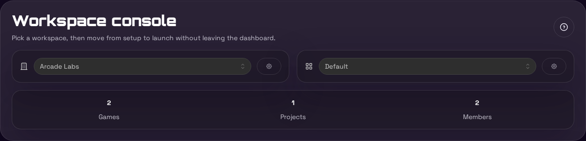
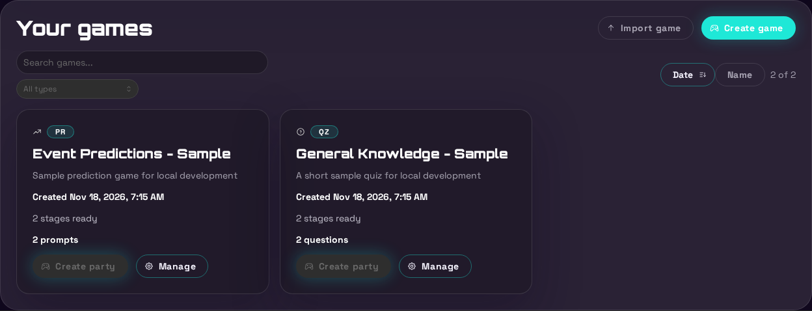
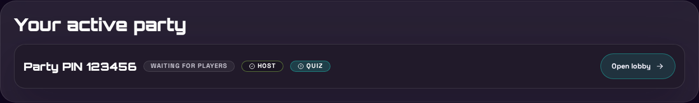

<!-- Generated by scripts/generate-usage-reference.mjs. Edit the source, then regenerate. -->

# Workspace console

[User guides](index.md) | [Français](fr/dashboard.md)

On your Pleey instance, open the relevant screen and select the question-mark button in its header to show the guide. The links below use the local installation; replace the host and any :parameter with your own address and resource identifier. Player guidance is available in the lobby before timed play.

## Choose your workspace

Choose an organization and a project. The game catalog belongs to the selected project.

[Show guide](http://pleey.localhost/workspace/dashboard?guide=dashboard-home)

## Create game

Create a quiz or a prediction game, then open its editor to add content. You need a selected project.

[Show guide](http://pleey.localhost/workspace/dashboard?guide=dashboard-home)

## Your games

Use a game card to create a party. Review its settings and optional password before confirming. Disabled actions explain what is missing.

[Show guide](http://pleey.localhost/workspace/dashboard?guide=dashboard-home)

## Your active party

Open your current party to invite players. Start from the host lobby once the game and players are ready.

[Show guide](http://pleey.localhost/workspace/dashboard?guide=dashboard-home)

## Reference

- [Party settings](generated/settings.md)
- [Resource permissions](generated/permissions.md)
- [Error codes](generated/errors.md)
- [Game types](generated/game-types.md)
