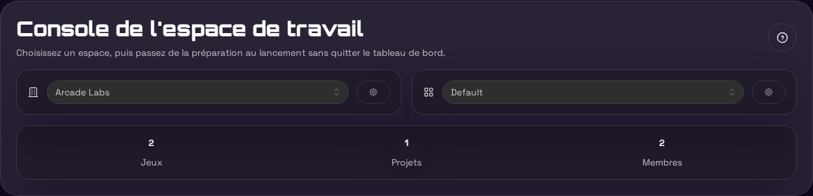
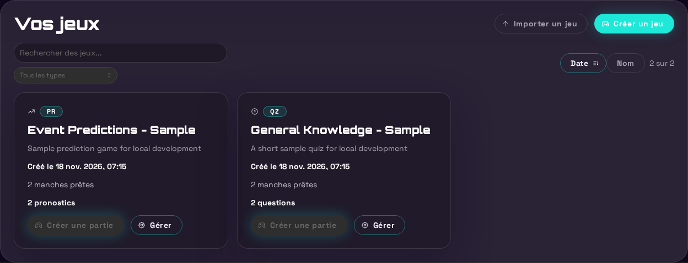
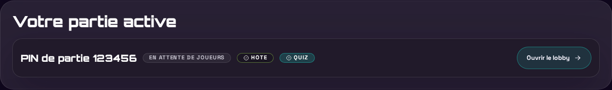

<!-- Generated by scripts/generate-usage-reference.mjs. Edit the source, then regenerate. -->

# Console de l'espace de travail

[Guides utilisateur](../index.md) | [English](../dashboard.md)

Sur votre instance Pleey, ouvrez l'écran concerné puis utilisez le bouton avec un point d'interrogation dans son en-tête pour voir le guide. Les liens ci-dessous utilisent l'installation locale. Remplacez l'hôte et les :paramètres par votre adresse et vos identifiants. Le guide joueur est disponible dans le lobby, avant le jeu chronométré.

## Choisissez votre espace

Choisissez une organisation et un projet. Le catalogue affiche les jeux du projet sélectionné.

[Voir le guide](http://pleey.localhost/workspace/dashboard?guide=dashboard-home)

## Créer un jeu

Créez un quiz ou un jeu de pronostics, puis ouvrez son éditeur pour ajouter du contenu. Sélectionnez d'abord un projet.

[Voir le guide](http://pleey.localhost/workspace/dashboard?guide=dashboard-home)

## Vos jeux

Utilisez la carte d'un jeu pour créer une partie. Vérifiez ses paramètres et son éventuel mot de passe avant de confirmer. Les actions désactivées indiquent ce qui manque.

[Voir le guide](http://pleey.localhost/workspace/dashboard?guide=dashboard-home)

## Votre partie active

Ouvrez votre partie en cours pour inviter des joueurs. Lancez-la depuis le lobby hôte une fois le jeu et les joueurs prêts.

[Voir le guide](http://pleey.localhost/workspace/dashboard?guide=dashboard-home)

## Référence

- [Paramètres de partie](generated/settings.md)
- [Droits sur les ressources](generated/permissions.md)
- [Codes d'erreur](generated/errors.md)
- [Types de jeu](generated/game-types.md)
