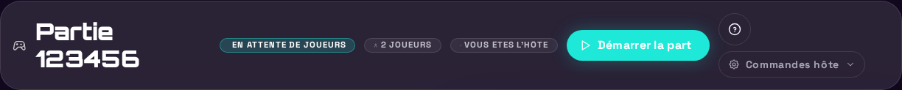
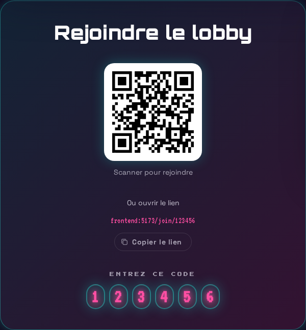
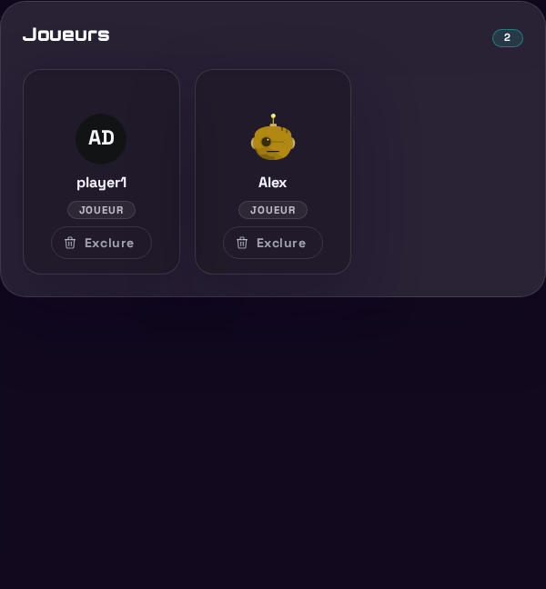

<!-- Generated by scripts/generate-usage-reference.mjs. Edit the source, then regenerate. -->

# Vous êtes l'hôte

[Guides utilisateur](../index.md) | [English](../host-party.md)

Sur votre instance Pleey, ouvrez l'écran concerné puis utilisez le bouton avec un point d'interrogation dans son en-tête pour voir le guide. Les liens ci-dessous utilisent l'installation locale. Remplacez l'hôte et les :paramètres par votre adresse et vos identifiants. Le guide joueur est disponible dans le lobby, avant le jeu chronométré.

## Démarrer la partie

Lancez la partie quand les joueurs ont rejoint le lobby et que le contenu est prêt. Pendant le jeu, avancez, mettez en pause ou révélez les résultats avec les commandes hôte. Lisez les confirmations avant de redémarrer ou terminer une partie.

[Voir le guide](http://pleey.localhost/party/:partyId/lobby?guide=host-party)

## Inviter des joueurs

Partagez le lien, le QR code ou le code de la partie. Pour une partie privée, transmettez aussi le mot de passe aux joueurs.

[Voir le guide](http://pleey.localhost/party/:partyId/lobby?guide=host-party)

## Joueurs

Vérifiez les joueurs présents avant de lancer la partie. L'hôte peut retirer un joueur de la partie.

[Voir le guide](http://pleey.localhost/party/:partyId/lobby?guide=host-party)

## Référence

- [Paramètres de partie](generated/settings.md)
- [Droits sur les ressources](generated/permissions.md)
- [Codes d'erreur](generated/errors.md)
- [Types de jeu](generated/game-types.md)
