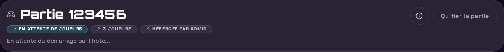
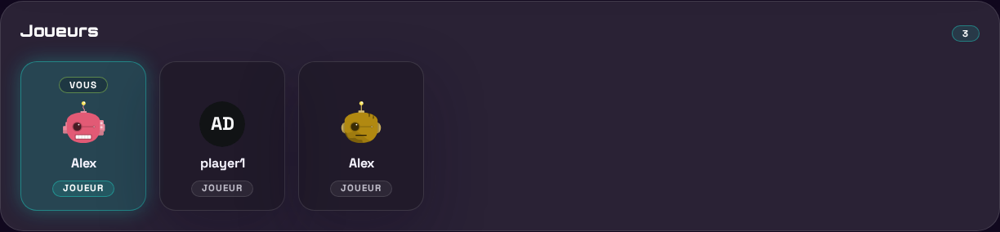

<!-- Generated by scripts/generate-usage-reference.mjs. Edit the source, then regenerate. -->

# Joueur

[Guides utilisateur](../index.md) | [English](../player-play.md)

Sur votre instance Pleey, ouvrez l'écran concerné puis utilisez le bouton avec un point d'interrogation dans son en-tête pour voir le guide. Les liens ci-dessous utilisent l'installation locale. Remplacez l'hôte et les :paramètres par votre adresse et vos identifiants. Le guide joueur est disponible dans le lobby, avant le jeu chronométré.

## Prêt·e à jouer ?

Attendez le lancement par l'hôte. Dans un quiz, sélectionnez les réponses avant la fin du timer. Dans un pronostic, choisissez une option et attendez le résultat.

[Voir le guide](http://pleey.localhost/party/:partyId/lobby?guide=player-play)

## Joueurs

La modification des réponses dépend des paramètres de la partie. Suivez les résultats et le classement entre les étapes. L'hôte donne le rythme.

[Voir le guide](http://pleey.localhost/party/:partyId/lobby?guide=player-play)

## Référence

- [Paramètres de partie](generated/settings.md)
- [Droits sur les ressources](generated/permissions.md)
- [Codes d'erreur](generated/errors.md)
- [Types de jeu](generated/game-types.md)
