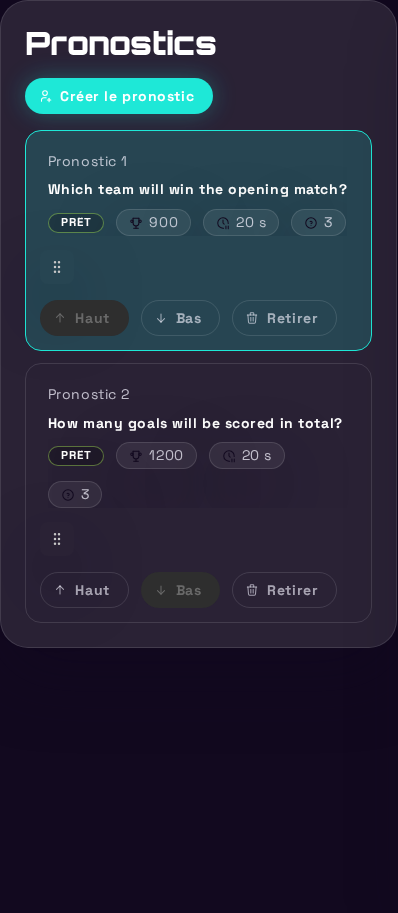
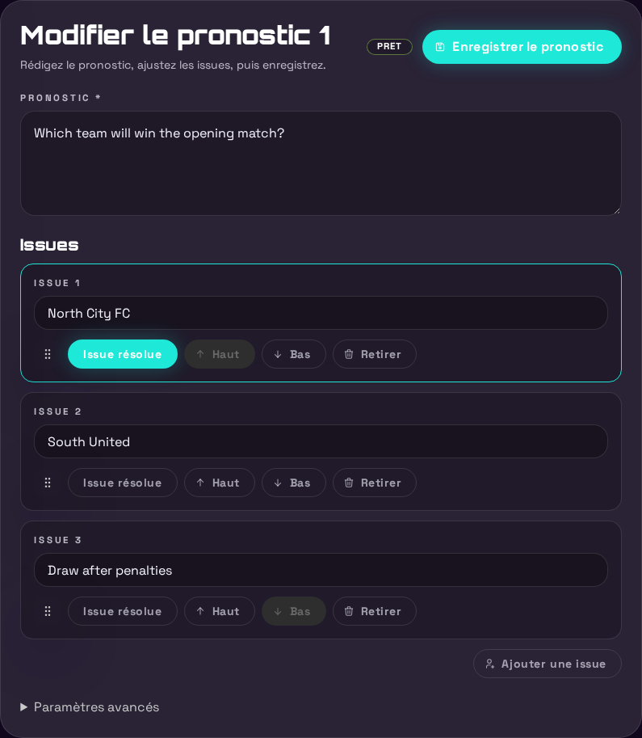

<!-- Generated by scripts/generate-usage-reference.mjs. Edit the source, then regenerate. -->

# Pronostic

[Guides utilisateur](../index.md) | [English](../prediction.md)

Sur votre instance Pleey, ouvrez l'écran concerné puis utilisez le bouton avec un point d'interrogation dans son en-tête pour voir le guide. Les liens ci-dessous utilisent l'installation locale. Remplacez l'hôte et les :paramètres par votre adresse et vos identifiants. Le guide joueur est disponible dans le lobby, avant le jeu chronométré.

## Configuration

Utilisez Configuration pour les détails du jeu. Les pronostics se préparent dans l'éditeur. Vérification contrôle le contenu avant le lancement.

[Voir le guide](http://pleey.localhost/predictions/:predictionId?guide=prediction-authoring)

## Pronostics

Ajoutez des pronostics et organisez leur ordre. Sélectionnez un pronostic pour modifier les options.

[Voir le guide](http://pleey.localhost/predictions/:predictionId?guide=prediction-authoring)

## Ajouter un pronostic

Rédigez le pronostic et ses options, puis enregistrez. Pendant la partie, l'hôte indique le résultat avant de le révéler.

[Voir le guide](http://pleey.localhost/predictions/:predictionId?guide=prediction-authoring)

## Référence

- [Paramètres de partie](generated/settings.md)
- [Droits sur les ressources](generated/permissions.md)
- [Codes d'erreur](generated/errors.md)
- [Types de jeu](generated/game-types.md)
