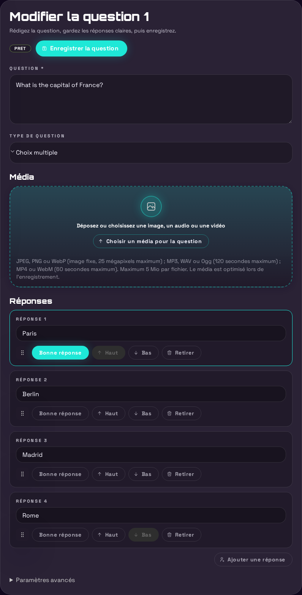

<!-- Generated by scripts/generate-usage-reference.mjs. Edit the source, then regenerate. -->

# Quiz

[Guides utilisateur](../index.md) | [English](../quiz.md)

Sur votre instance Pleey, ouvrez l'écran concerné puis utilisez le bouton avec un point d'interrogation dans son en-tête pour voir le guide. Les liens ci-dessous utilisent l'installation locale. Remplacez l'hôte et les :paramètres par votre adresse et vos identifiants. Le guide joueur est disponible dans le lobby, avant le jeu chronométré.

## Configuration

Utilisez Configuration pour le titre et la description. Questions contient l'éditeur. Vérification contrôle le contenu avant le lancement.

[Voir le guide](http://pleey.localhost/quizzes/:quizId?guide=quiz-authoring)

## Questions

Ajoutez des questions et réorganisez leur ordre dans la liste. Sélectionnez une question pour la modifier.

[Voir le guide](http://pleey.localhost/quizzes/:quizId?guide=quiz-authoring)

## Ajouter une question

Rédigez la question, ajoutez des réponses et indiquez les bonnes réponses. Choisissez la durée et les points, puis enregistrez. Une question vrai/faux a une seule bonne réponse.

[Voir le guide](http://pleey.localhost/quizzes/:quizId?guide=quiz-authoring)

## Référence

- [Paramètres de partie](generated/settings.md)
- [Droits sur les ressources](generated/permissions.md)
- [Codes d'erreur](generated/errors.md)
- [Types de jeu](generated/game-types.md)
