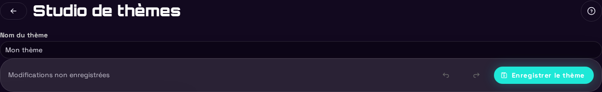
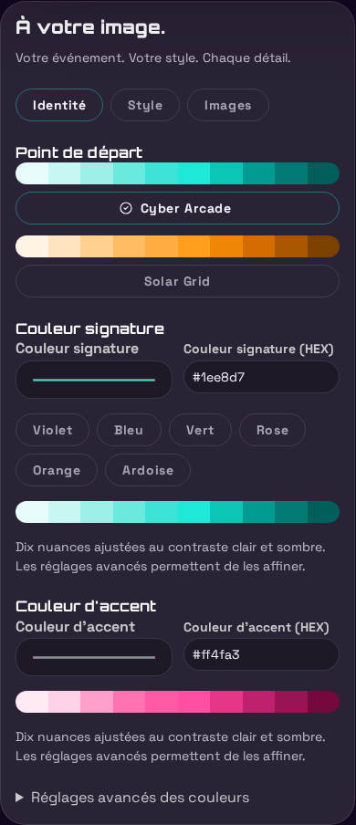

<!-- Generated by scripts/generate-usage-reference.mjs. Edit the source, then regenerate. -->

# Éditeur de thème

[Guides utilisateur](../index.md) | [English](../themes.md)

Sur votre instance Pleey, ouvrez l'écran concerné puis utilisez le bouton avec un point d'interrogation dans son en-tête pour voir le guide. Les liens ci-dessous utilisent l'installation locale. Remplacez l'hôte et les :paramètres par votre adresse et vos identifiants. Le guide joueur est disponible dans le lobby, avant le jeu chronométré.

## Studio de thèmes

Choisissez un thème de départ dans la bibliothèque. Nommez votre thème et enregistrez quand il est prêt. L'enregistrement nécessite les droits dans cette organisation.

[Voir le guide](http://pleey.localhost/workspace/organizations/:organizationId/themes/new?guide=theme-studio)

## Réglages du thème

Réglez les couleurs, le style et les médias. Vérifiez le rendu avant d'enregistrer. Sur téléphone, alternez entre édition et aperçu.

[Voir le guide](http://pleey.localhost/workspace/organizations/:organizationId/themes/new?guide=theme-studio)

## Référence

- [Paramètres de partie](generated/settings.md)
- [Droits sur les ressources](generated/permissions.md)
- [Codes d'erreur](generated/errors.md)
- [Types de jeu](generated/game-types.md)
