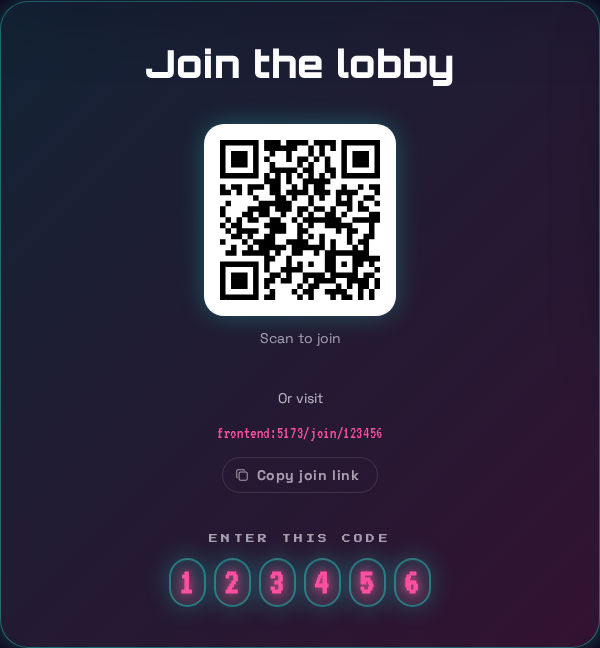
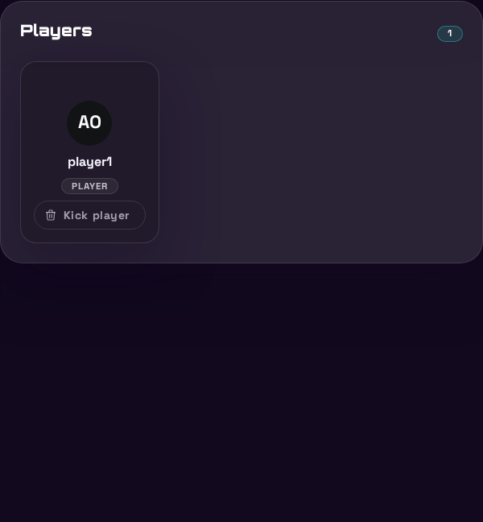

<!-- Generated by scripts/generate-usage-reference.mjs. Edit the source, then regenerate. -->

# You are hosting

[User guides](index.md) | [Français](fr/host-party.md)

On your Pleey instance, open the relevant screen and select the question-mark button in its header to show the guide. The links below use the local installation; replace the host and any :parameter with your own address and resource identifier. Player guidance is available in the lobby before timed play.

## Start party

Start when players have joined and content is ready. During play, use the host controls to advance, pause or reveal results. Read confirmations before restarting or ending a party.

[Show guide](http://pleey.localhost/party/:partyId/lobby?guide=host-party)

## Invite players

Share the join link, QR code or party code. For a private party, share the password with your players too.

[Show guide](http://pleey.localhost/party/:partyId/lobby?guide=host-party)

## Players

Check the players in the lobby before starting. The host can remove a player from the party.

[Show guide](http://pleey.localhost/party/:partyId/lobby?guide=host-party)

## Reference

- [Party settings](generated/settings.md)
- [Resource permissions](generated/permissions.md)
- [Error codes](generated/errors.md)
- [Game types](generated/game-types.md)
