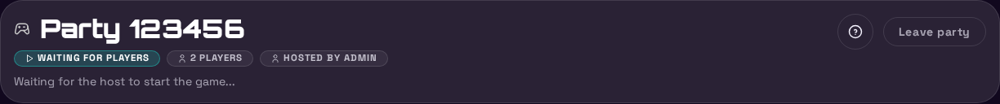
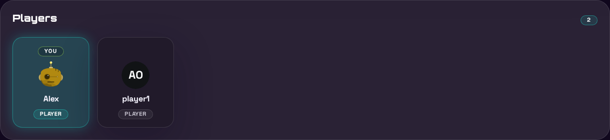

<!-- Generated by scripts/generate-usage-reference.mjs. Edit the source, then regenerate. -->

# Player

[User guides](index.md) | [Français](fr/player-play.md)

On your Pleey instance, open the relevant screen and select the question-mark button in its header to show the guide. The links below use the local installation; replace the host and any :parameter with your own address and resource identifier. Player guidance is available in the lobby before timed play.

## Ready to play?

Wait for the host to start. During a quiz, select the answers before the timer ends. During a prediction, choose an outcome and wait for the result.

[Show guide](http://pleey.localhost/party/:partyId/lobby?guide=player-play)

## Players

Answer changes depend on the party settings. Follow the results and leaderboard between stages; the host controls the pace.

[Show guide](http://pleey.localhost/party/:partyId/lobby?guide=player-play)

## Reference

- [Party settings](generated/settings.md)
- [Resource permissions](generated/permissions.md)
- [Error codes](generated/errors.md)
- [Game types](generated/game-types.md)
