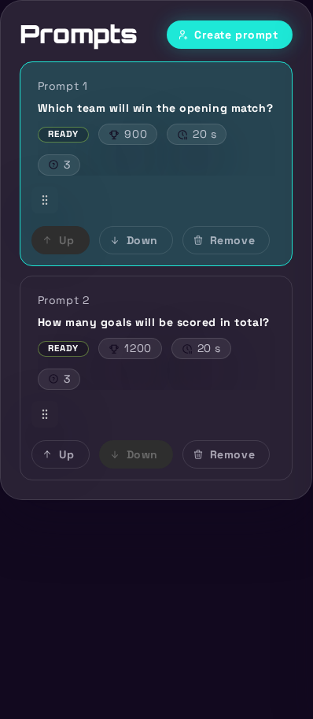
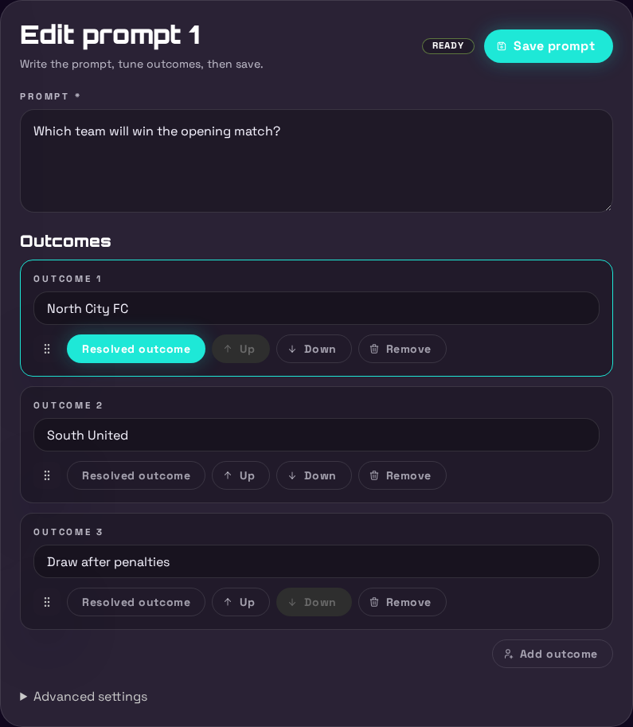

<!-- Generated by scripts/generate-usage-reference.mjs. Edit the source, then regenerate. -->

# Prediction

[User guides](index.md) | [Français](fr/prediction.md)

On your Pleey instance, open the relevant screen and select the question-mark button in its header to show the guide. The links below use the local installation; replace the host and any :parameter with your own address and resource identifier. Player guidance is available in the lobby before timed play.

## Setup

Use Setup for the game details. Prompts holds the editor; Review checks readiness before hosting.

[Show guide](http://pleey.localhost/predictions/:predictionId?guide=prediction-authoring)

## Prompts

Add prompts and arrange their order. Select a prompt to edit the possible outcomes.

[Show guide](http://pleey.localhost/predictions/:predictionId?guide=prediction-authoring)

## Add prompt

Write a prompt and its possible outcomes, then save. During the party, the host resolves the outcome before revealing results.

[Show guide](http://pleey.localhost/predictions/:predictionId?guide=prediction-authoring)

## Reference

- [Party settings](generated/settings.md)
- [Resource permissions](generated/permissions.md)
- [Error codes](generated/errors.md)
- [Game types](generated/game-types.md)
