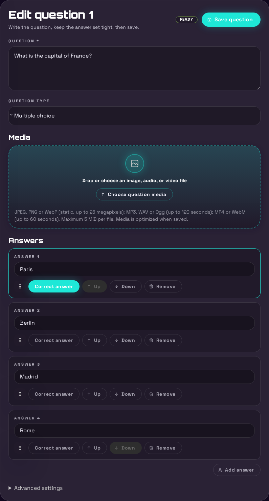

<!-- Generated by scripts/generate-usage-reference.mjs. Edit the source, then regenerate. -->

# Quiz

[User guides](index.md) | [Français](fr/quiz.md)

On your Pleey instance, open the relevant screen and select the question-mark button in its header to show the guide. The links below use the local installation; replace the host and any :parameter with your own address and resource identifier. Player guidance is available in the lobby before timed play.

## Setup

Use Setup for the game title and description. Questions holds the editor; Review checks readiness before hosting.

[Show guide](http://pleey.localhost/quizzes/:quizId?guide=quiz-authoring)

## Questions

Add questions and arrange their order in the list. Select a question to edit it.

[Show guide](http://pleey.localhost/quizzes/:quizId?guide=quiz-authoring)

## Add question

Write the question, add answers and mark the correct ones. Choose the duration and points, then save. True/false questions have one correct answer.

[Show guide](http://pleey.localhost/quizzes/:quizId?guide=quiz-authoring)

## Reference

- [Party settings](generated/settings.md)
- [Resource permissions](generated/permissions.md)
- [Error codes](generated/errors.md)
- [Game types](generated/game-types.md)
