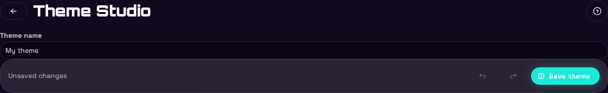
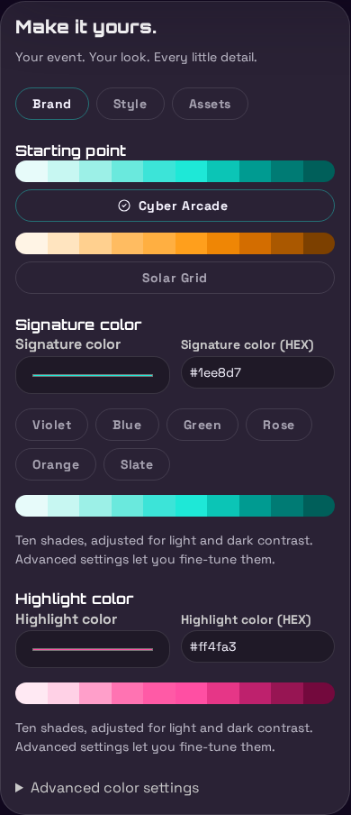

<!-- Generated by scripts/generate-usage-reference.mjs. Edit the source, then regenerate. -->

# Theme editor

[User guides](index.md) | [Français](fr/themes.md)

On your Pleey instance, open the relevant screen and select the question-mark button in its header to show the guide. The links below use the local installation; replace the host and any :parameter with your own address and resource identifier. Player guidance is available in the lobby before timed play.

## Theme Studio

Choose a starting theme from the library. Name your theme and save when ready. Saving requires permission in this organization.

[Show guide](http://pleey.localhost/workspace/organizations/:organizationId/themes/new?guide=theme-studio)

## Theme controls

Adjust brand colors, style and assets. Preview your changes before saving. On a phone, switch between editing and preview.

[Show guide](http://pleey.localhost/workspace/organizations/:organizationId/themes/new?guide=theme-studio)

## Reference

- [Party settings](generated/settings.md)
- [Resource permissions](generated/permissions.md)
- [Error codes](generated/errors.md)
- [Game types](generated/game-types.md)
